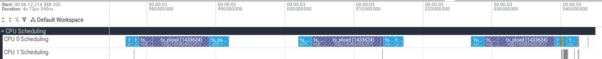
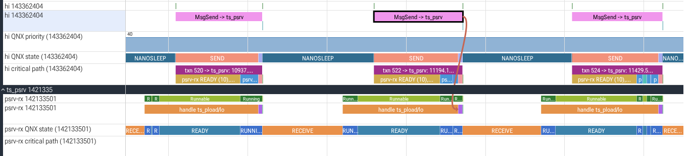
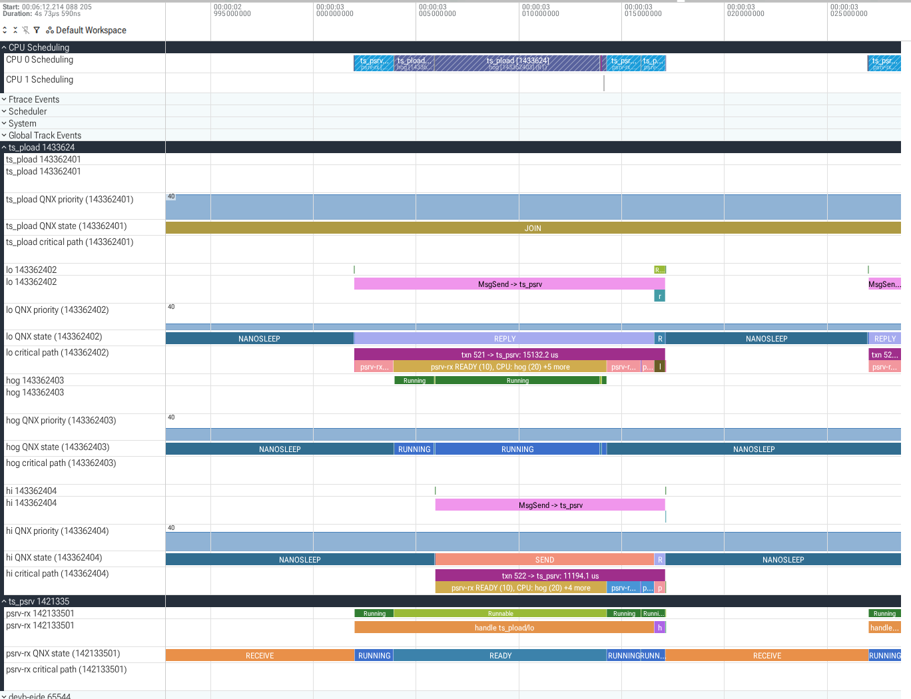
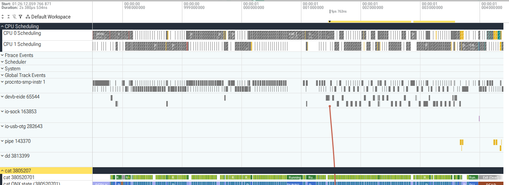
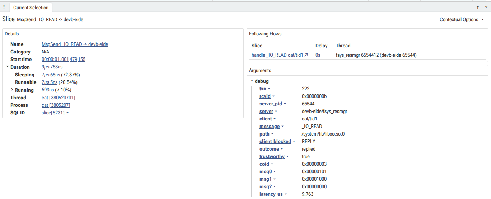

# trace-studio

trace-studio reads QNX OS 8.0 kernel event traces (`.kev` files written by `tracelogger`) on a development host, converts them to Perfetto traces, and analyses QNX message passing in them. It is for engineers who need to explain a deadline miss in a system built from communicating processes: which server a client waited for, what that server was doing, who held the CPU it needed, and whether the cause was a priority inversion.

What it does:

- Reads `.kev` files directly with its own parser, so no QNX libraries are needed on the host. Its events and arguments matched the SDP's `traceprinter` exactly on the 14 captures listed below.
- Converts to a Perfetto trace: per-CPU scheduling tracks, QNX thread states as the kernel reports them (SEND, RECEIVE, REPLY, MUTEX, ...), QNX priorities, each message exchange it can link with the server's handling and reply joined by arrows, resource-manager message names (`MsgSend _IO_READ -> devb-eide`) with the path the file was opened with, pulses, interrupts, and a critical-path track per client thread.
- `analyze`: latency per client and server, deadline misses, suspected priority inversions with the evidence, and the critical path of any request.
- `diff`: before and after comparison of two traces.
- Says when it does not know: exchanges that cross lost events, carry contradictory kernel information or have an ambiguous parent are kept but excluded from the analyses and counted; conclusions the trace cannot support are reported as "insufficient evidence" or "not explained by the trace".

## Install

Python 3.10 or newer.

```
git clone https://github.com/NikhilGogu/qnx-trace-studio.git && cd qnx-trace-studio
python3 -m venv venv && venv/bin/pip install .
venv/bin/tracestudio --help
```

Dependencies: `perfetto` 0.59.x (its generated protobuf classes, and TraceProcessor for the tests) and `protobuf` 7.x. Only `convert` needs them at run time.

## Capture on QNX 8.0

Run `tracelogger` as root on the target. trace-studio needs all classes (thread states, process names, kernel calls, COMM, CONTROL), which is what non-daemon mode logs. Wide mode (`-w`) adds priorities, `_msg_info` and the first 12 bytes of each message, which the inversion analysis needs.

```
tracelogger -w -k 32 -b 128 -s 4 -f /tmp/trace.kev      # 4 seconds, wide mode
```

`-k 32` asks for 32 kernel buffers of 16 KB per CPU and `-b 128` for tracelogger-side buffers; with these, none of the captures below lost a buffer or dropped an event. Copy the file to the host (`scp target:/tmp/trace.kev .`).

The inversion analysis needs to know which CPUs the server may use, so it uses run masks set during the trace with `ThreadCtl(_NTO_TCTL_RUNMASK)`; for a server whose mask was set before the trace started, the result is "insufficient evidence".

The example traces were captured on QNX 8.0.0 x86_64 under QEMU/KVM (image built with `mkqnximage --type=qemu --arch=x86_64`, 2 CPUs, 1 GB). The workload in `workload/` (build with `source qnxsdp-env.sh && make -C workload`, which runs `qcc -Vgcc_ntox86_64`) and `workload/run_scenarios.sh` reproduce them:

```
sh run_scenarios.sh /tmp/ts/bin /tmp/ts/out prio_fixed prio_inherit
```

| scenario | what runs |
|---|---|
| `ipc_wide`, `ipc_fast` | ts_front (2 receive threads) forwards every fourth request to ts_back; 4 client threads, 40 requests each; pulses |
| `prio_fixed`, `prio_inherit` | on CPU 0: lo (prio 10) asks ts_psrv for 4 ms of work, hog (20) burns 10 ms, hi (30) asks for 0.5 ms with a 5 ms deadline; ts_psrv's channel with or without `_NTO_CHF_FIXED_PRIORITY` |
| `prio_fixed_rx`, `prio_inherit_rx` | as above, but the hog starts after ts_psrv already received hi's request |
| `cancel` | requests that end by TimerTimeout (ETIMEDOUT) or a signal (EINTR) while the server replies late |
| `rm_traffic`, `rm_small` | `ls`, `find`, `cat`, `dd`, `wc` on the qnx6 file systems served by devb-eide |

Each workload process also writes a CSV log of what it did (ClockCycles(), ids, rcvids), which `tracestudio validate` compares with the decoded trace.

## Convert and open in Perfetto

```
tracestudio convert trace.kev                  # writes trace.perfetto-trace
```

Open the output in https://ui.perfetto.dev ("Open trace file"). The trace stays in the browser. You can also query it with Perfetto SQL (`trace_processor_shell` or the `perfetto` Python package).

Each thread has its slice track (MsgSend, handle, MsgReply, pulses) and three child tracks: `QNX state` (the kernel's thread states, `qnx_prio` argument, UNKNOWN where data was lost), `QNX priority` (when it changes) and `critical path`. Slices carry `txn`, `rcvid`, `coid`, `message`, `path`, `latency_us`, `trustworthy` and any `warnings` as arguments; click a slice to see them and follow its arrows. A message type is named (`_IO_READ`) only on a connection known to be a resource-manager connection; otherwise `message` gives its number (`type 0x0101`).

Screenshots from ui.perfetto.dev (traces from `tests/data`):

CPU 0 in `prio_fixed`: hog (hatched) holds the CPU while psrv-rx is preempted.



hi's `MsgSend -> ts_psrv` selected: the arrow lands on psrv-rx's handling of hi's request, which starts only after psrv-rx finishes lo's request.



The same period with all tracks: QNX states (SEND, READY, ...) and the critical-path tracks (`txn 522 -> ts_psrv: 11194.1 us`, `psrv-rx READY (10), CPU: hog (20)`).



With priority inheritance (`prio_inherit`), psrv-rx's QNX priority rises from 10 to 30 the moment hi sends, while psrv-rx still handles lo's request; it then preempts hog.


Resource-manager traffic (`rm_small`): `cat`'s `MsgSend _IO_READ -> devb-eide` with its arrow to devb-eide's `fsys_resmgr` thread, and its arguments.




## Analyze

```
tracestudio analyze prio_fixed.kev --deadline hi=5000
```

prints latency per client and server, deadline misses, suspected inversions and fixed-priority channels (abridged, long lines wrapped):

```
trace prio_fixed.kev: 690 message exchanges, 672 trustworthy (analyses use only those)
deadline hi=5000 us on ts_psrv: 20 of 20 requests missed, max 11429.5 us
suspected priority inversions: 20 (checked 672 exchanges, 15 excluded as untrustworthy, threshold 100 us)
  txn 520: ts_pload/hi (prio 30) waited 10937.8 us in MsgSend; for 8151.9 us of it (SEND-blocked 8151.9 us)
  ts_psrv/psrv-rx was READY at prio 10 while every CPU it may run on (CPU 0, run mask 0x1) ran a thread above
  prio 10, at least one of them below the client's 30; most of the time ts_pload/hog (prio 20) on CPU 0,
  8151.9 us; the server was busy with ts_pload/lo's request (txn 519).
channels created with _NTO_CHF_FIXED_PRIORITY: ts_psrv chid 1
```

A suspected inversion needs evidence for every instant it counts: the client SEND- or REPLY-blocked on the server thread; the server READY at a lower priority than the client (priorities as known at that instant); the server's run mask traced and not invalidated since; every CPU in that mask busy with threads above the server, at least one of them below the client. While the client is SEND-blocked the server thread must also be provably the only thread of its process, since another one could receive the message. When the trace cannot show why a low-priority server was not running (untraced run mask, idle CPU, lost events, other possible receivers, sporadic scheduling, adaptive partitioning), the request is reported as "insufficient evidence" with the reasons. Use `--json` for everything, including all inversions.

## Critical path

```
tracestudio analyze prio_fixed.kev --request 524     # the txn argument shown in Perfetto
tracestudio analyze trace.kev --slowest 5            # the 5 slowest top-level requests
```

partitions the client's MsgSend latency into consecutive segments that add up exactly, recursing into trustworthy requests the server sends to other servers:

```
txn 524: ts_pload/hi -> ts_psrv, MsgSend latency 11429.5 us
   start us       us      %  what
      0.0      0.5    0.0  ts_pload/hi running
      0.5   8143.0   71.2  ts_psrv/psrv-rx READY at prio 10, CPUs held by ts_pload/hog (prio 20) on CPU 0 8142.8 us, ...
   8143.5    789.7    6.9  ts_psrv/psrv-rx running ts_pload/lo's request (txn 523)
   ...
  10898.1    530.0    4.6  ts_psrv/psrv-rx running this request
  11428.5      0.5    0.0  ts_pload/hi READY at prio 30, not explained by the trace: CPU 0 ran ts_psrv/psrv-rx (prio 10) 0.5 us
   by kind: server preempted 8702.3 us, server busy 2193.5 us, server running 532.1 us, client running 1.1 us, unexplained ready 0.5 us
```

A forwarded request (`ipc_wide`, txn 975) shows the nested server inline, and a wait the trace cannot explain as such:

```
    110.2    209.8   37.9  ts_front/front-rx0 waits for ts_back (txn 977)
    110.8    208.4   37.6    ts_back/back-rx running this request
    320.0     47.0    8.5  ts_front/front-rx0 READY at prio 10, not explained by the trace: CPU 0 idle (no run mask traced) 47.0 us
```

Segment kinds: client running, client ready, server waiting, server busy (with another request, or holding several), server preempted, server running, nested request, server blocked, unexplained ready, unknown. A wait is "preempted" or "ready" only when every CPU the thread may use ran a known thread at or above its priority. `convert` writes the same segments to each client thread's `critical path` track.

## Diff

```
tracestudio diff prio_fixed.kev prio_inherit.kev --deadline hi=5000 --client ts_pload/hi
```

```
deadline hi=5000 us on ts_psrv: before 20/20 missed, max 11429.5 us | after 0/20 missed, max 2740.4 us
suspected priority inversions: before 20 | after 0 (insufficient evidence: 0 | 0)
fixed-priority channels: before ts_psrv chid 1 | after none
MsgSend latency (us), 2 pairs with the largest p99 change:
  client@priority                server                      n       p50       p90       p99       max  excluded/unfinished
  ts_pload/hi@30                 ts_psrv          before    20   10883.2   11141.9   11429.5   11429.5  0/0
  ts_pload/hi@30                 ts_psrv          after     20    2686.6    2725.9    2740.4    2740.4  0/0
  ...
server priority while handling each client's request (share of the server's running time):
  ts_psrv/psrv-rx for ts_pload/hi: before prio 10 100% | after prio 30 100%
```

Rows are matched by role (client process, thread name and priority, server process). Server running time while it holds several requests is counted once, under "(several requests open)".

Other commands: `tracestudio info trace.kev` (header, losses, decoder counters as JSON) and `tracestudio validate trace.kev --logs DIR` (ground-truth check against the workload logs; exit status 1 if anything does not match).

## Support matrix

| | status |
|---|---|
| QNX SDP 8.0.0, x86_64, QEMU/KVM, 2 CPUs | verified on 14 captures |
| tracelogger wide mode (`-w`) | verified |
| fast mode | verified for message linking and message names (msg[0] keeps the `_IO_CONNECT` subtype); no priorities, so no inversion analysis |
| per-class mix of fast and wide events | unit tests only |
| aarch64le targets, more than 2 CPUs, real hardware | untested |
| big-endian traces | not supported (refused) |
| lost buffers, buffers missing slots, DROPPED events, truncated files | unit tests and fault injection; no capture with real loss yet |
| interrupted kernel calls (INT_CALL) | decoded as documented, never seen in a capture: timeouts and signals ended MsgSend with KER_EXIT and status -1 |
| adaptive partitioning, sporadic scheduling, QVM guests | untested; inversion analysis reports insufficient evidence when they appear |
| Python 3.10 and 3.12 | verified (`pip install .` in fresh venvs, test suite) |
| Perfetto UI | checked in ui.perfetto.dev v59 |

## Validation evidence

All numbers come from commands run on the build box (Ubuntu 22.04, QNX SDP 8.0) against the 14 captures from the QEMU target described above. They show that trace-studio handles these workloads on this target; they are fixture coverage, not a proof for every trace. The commands and logs are listed in `docs/DESIGN.md`.

- Parser against `traceprinter` (`tools/compare_traceprinter.py`): 672,043 events identical in timestamp, CPU, class and event; 2,198,839 argument values compared, 0 mismatches. The largest capture (`rm_traffic`, 12.4 MB) has 306,436 events.
- Message linking against the workload's own logs (`tracestudio validate`): 1,040 of 1,040 logged requests matched to the right client thread, server thread and rcvid (480 in run 1, 480 in run 2, 80 in run 3), including all 160 forwarded requests of runs 1 and 2 linked to their parent, with rcvids reused up to 186 times.
- Inversions: 20 of 20 hi requests flagged with a fixed-priority channel and 0 with inheritance, both when the hog strikes before the receive (`prio_fixed`, median 8.2 ms of evidence each, SEND-blocked) and after it (`prio_fixed_rx`, median 10.0 ms, REPLY-blocked); 0 in the wide-mode IPC capture. Fast mode records no priorities, so for `ipc_fast` 12 requests are reported as insufficient evidence and none as inversions. Deadline misses at 5 ms: 20/20 versus 0/20 in both pairs.
- Cancellation (`cancel`): all 15 logged sends decoded with the logged outcome (5 replied, 10 cancelled by ETIMEDOUT or EINTR), and the 10 late MsgReply calls that failed in the log are exactly the 10 replies the decoder could not attach to any exchange.
- Resource managers: the bytes `cat` read through each coid path equal the file sizes for all 26 files in `rm_traffic` (librcheck.so is a symlink and counts under librcheck.so.1) and both files in `rm_small`; 81 messages in `rm_traffic` carry an `_IO_*` type number on connections not known to be resource-manager connections and are left unnamed.
- Fault injection (`tools/drop_buffer.py`): removing 4 of the 15 kernel buffers inside the workload window of `ipc_wide` leaves 108 of 200 requests matched, 62 without a candidate, none matched to a wrong exchange in that test, and validation fails as it should.
- Perfetto import: TraceProcessor 0.59.1 loads all 14 converted captures with no error or data-loss stats; every flow joins slices of one transaction; no slice has a negative duration.
- Tests: `python3 tests/test_tracestudio.py` (or pytest) runs 57 tests: 47 on synthetic slot streams, including a counterexample for each finding of the second review (deleted middle slots, unanchored timestamps, losses at trace start, READY inside a loss window, partial thread events, untraced run masks, inheriting channels, other possible receivers, sporadic scheduling, clipped attribution, untrustworthy children, unreplied requests, idle CPUs, empty masks, stale replies, ambiguous parents, wakeups without evidence, pulse queues out of sync, unrelated ConnectAttach, unqualified `_IO_*` numbers, same-named threads, overlapping handling), and 10 on the captures in `tests/data` (including CLI exit codes). With `TS_REQUIRE_ALL=1` a missing `traceprinter` or perfetto package fails the run; all 57 pass that way on the build box.
- Speed on the build box: `ipc_wide` (1.7 MB, 44,807 events) converts in 0.86 s with 102 MB peak memory; `rm_traffic` in 7.4 s with 725 MB; `analyze` takes 0.4 s and 2.7 s.

## Limitations

- The thread that runs a kernel call is inferred as the last thread switched in on that CPU. This held for every logged request, but it is an inference; it becomes "unknown" inside loss windows and after a migration until the next switch.
- Fast-mode traces carry no priorities, `_msg_info` or message payload beyond msg[0]: no inversion analysis and no pulse values.
- Wakeups appear in Perfetto ("woken by") only with object evidence: the woken thread later receives the message or pulse sent in the waker's kernel call, or the waker's reply names it. Timer, interrupt, synchronisation-object and cross-CPU wakeups have no waker; the QNX state track still shows READY.
- Perfetto's own thread-state view maps QNX states to Linux ones (blocked states become "Sleeping"); the `QNX state` track has the kernel's states. The priority column of Perfetto's sched table holds the QNX priority (0 to 255, higher wins), not a Linux prio.
- The inversion analysis needs the server's run mask traced (`ThreadCtl` during the trace) and, while SEND-blocked, a single-threaded server process; it is one level deep (it does not chain through a server that is itself blocked on another server or a mutex).
- The critical path follows trustworthy nested requests, not mutexes, condvars or handoffs to other threads (it says "handed off, not followed"); a server holding several received requests is reported as such, since the trace does not say which one it works on.
- A coid gets a path only from a confirmed open in the trace (PATHMGR event of the opening thread, ConnectAttach within 10 ms, first message an `_IO_CONNECT` answered without error); files opened before the trace started have no path.
- Pulses are linked only when exactly one send can match a receive on a queue that is in sync (the receiver blocked on the channel since the last loss or ambiguity); otherwise the candidates are recorded and no arrow is drawn.
- In the pinned priority runs the workload's own ClockCycles() is about 15 us before the traced MsgSendv entry; the cause is not known. It does not affect linking.

## How this was built

trace-studio was written by AI coding agents (Claude Opus 5.5 in Claude Code) working for our team on a build box with QNX SDP 8.0 and QEMU, and reviewed by a second model (GPT-6 Astra in Codex CLI) before each release; its findings and what we did about them are in docs/DESIGN.md. QNX behaviour comes only from the QNX headers and documentation and from black-box comparison with traceprinter. Every number in this README comes from a command that ran on QNX OS 8.0 captures; the commands are in docs/DESIGN.md.

## Licence

Apache-2.0, see `LICENSE`.
