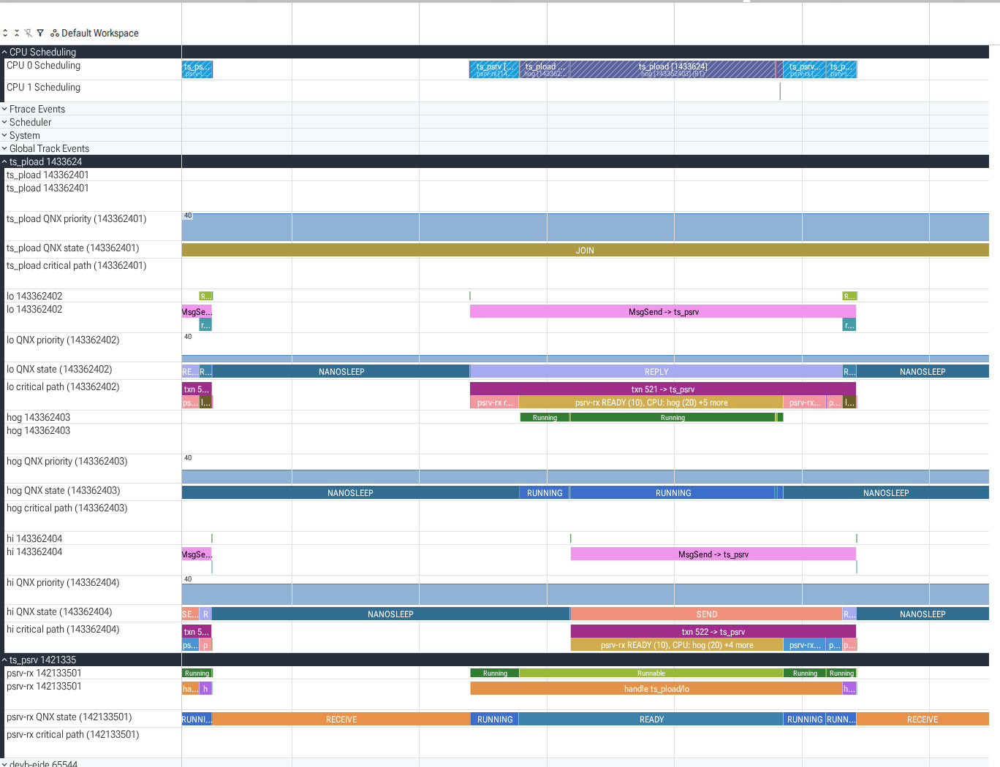
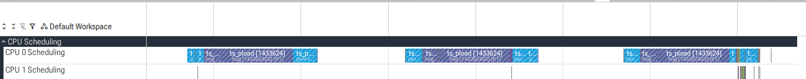
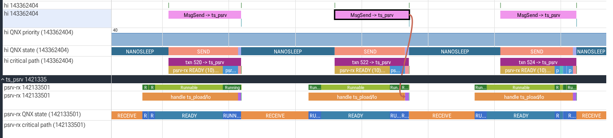
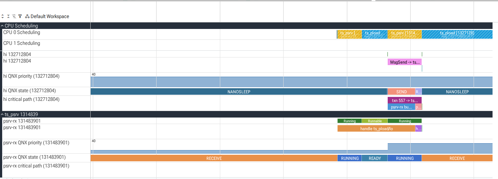
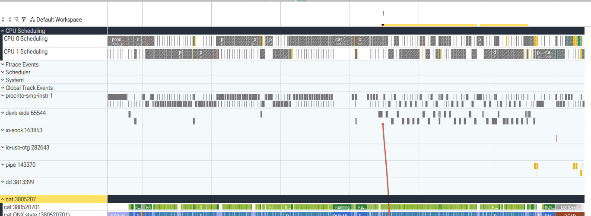
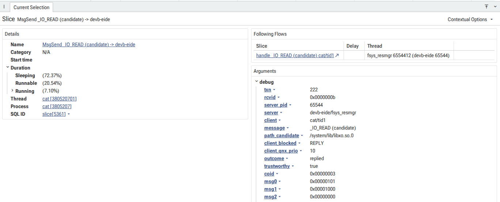
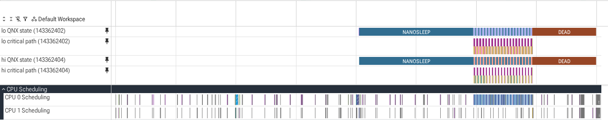

# trace-studio

trace-studio explains missed deadlines on QNX OS 8.0 from a kernel trace. It reads the `.kev` file that `tracelogger` writes and tells you which server a client waited for, what that server was doing, who held the CPU it needed, and whether the trace shows a suspected priority inversion, with the evidence for each verdict. It converts the trace to a Perfetto timeline. It runs as a command-line tool on a development host, so the same check can gate a CI build.

It is for developers of QNX message-passing systems who need to know why a request was late. The quickstart below runs on traces in this repository, with no QNX target or licence.



A high-priority client (`hi`) waits in SEND while a medium-priority thread (`hog`) holds the only CPU the server may use. The critical-path track under `hi` names the cause.

- Demo video (under 3 minutes): https://youtu.be/YeNumwjDXUk
- For judges: [where to find the evidence for each criterion](#for-judges)
- Codelab: [Find a priority inversion in QNX message passing](https://nikhil-qnx-codelabs.pages.dev/find-priority-inversion/) (source in [codelab/](codelab/find-priority-inversion.md))

## Try it without a QNX target

The repository carries kernel traces captured on QNX 8.0 (`tests/data`), so the analysis runs on any host with Python 3.10 or newer. No QNX licence or target is needed for this part.

```
git clone https://github.com/NikhilGogu/qnx-trace-studio.git && cd qnx-trace-studio
python3 -m venv venv && venv/bin/pip install .

# 1. A server whose channel has priority inheritance turned off: why does hi miss its 5 ms deadline?
venv/bin/tracestudio analyze tests/data/run1/prio_fixed.kev.gz --deadline hi=5000

# 2. The same workload with inheritance on: what changed?
venv/bin/tracestudio diff tests/data/run1/prio_fixed.kev.gz tests/data/run1/prio_inherit.kev.gz --deadline hi=5000

# 3. Look at it in Perfetto, with the tracks that matter pinned
venv/bin/tracestudio open tests/data/run1/prio_fixed.kev.gz

# 4. The same question as a CI gate: exit status 1 for the first trace, 0 for the second
venv/bin/tracestudio check tests/data/run1/prio_fixed.kev.gz --deadline hi@ts_psrv=5000 --no-inversions --client ts_pload/
venv/bin/tracestudio check tests/data/run1/prio_inherit.kev.gz --deadline hi@ts_psrv=5000 --no-inversions --client ts_pload/

# 5. A mutex without priority inheritance: whose lock did hi's server wait on, and what was the owner doing?
venv/bin/tracestudio analyze tests/data/run4/mutex_chain_nopi.kev.gz --slowest 1 --client ts_mutex/hi
```

Step 1 reports that 20 of 20 `hi` requests missed the deadline and lists 20 suspected priority inversions. Each one comes with its evidence, for example:

```
txn 520: ts_pload/hi (prio 30) waited 10937.8 us in MsgSend; for 8151.9 us of it (SEND-blocked 8151.9 us)
  ts_psrv/psrv-rx was READY at prio 10 while every CPU it may run on (CPU 0, run mask 0x1) ran a thread
  above prio 10, at least one of them below the client's 30; most of the time ts_pload/hog (prio 20) on CPU 0
```

Step 2 shows 0 of 20 misses and no inversions once the channel inherits the client's priority.

To see every checked-in capture on one page, with a button that opens each in Perfetto:

```
venv/bin/python tools/build_examples.py --out site --with-timing
python3 -m http.server -d site 8000        # then open http://127.0.0.1:8000
```

Without `--with-timing` the page replaces every measured time with "[timing withheld]". That is the version `.github/workflows/pages.yml` publishes, because the QNX licence does not allow publishing performance results without approval.

The fixed-priority channel in steps 1 to 4 is a controlled demo: the workload turns inheritance off on purpose. Step 5 is the more common case. A mutex created with `PTHREAD_PRIO_NONE` is held by a low-priority thread that waits on another server, and the critical path follows the chain from hi's server thread to the mutex owner and into the owner's own request, where a medium-priority hog holds the CPU (output under [Mutex owner chains](#mutex-owner-chains)). The inversion rule follows the same chain, so `tracestudio check tests/data/run4/mutex_chain_nopi.kev.gz --no-inversions --client ts_mutex/hi` fails and names the mutex owner and the hog, while the same gate passes on `mutex_chain_hog`, where the mutex has priority inheritance. Thread-pool servers are covered by the inversion rule too, so far on synthetic traces only (see [Limitations](#limitations)).

## For judges

| criterion | where to look |
|---|---|
| Technological implementation | Its own `.kev` parser ([tracestudio/kev.py](tracestudio/kev.py)), checked event by event against the SDP's `traceprinter` ([docs/VALIDATION.md](docs/VALIDATION.md)). The message-passing model in [tracestudio/model.py](tracestudio/model.py). 110 tests in [tests/](tests), run by [CI](.github/workflows/test.yml) on Python 3.10 and 3.12 |
| Design | The quickstart above runs on the checked-in captures without QNX. `check` gives an exit status and JUnit XML, and [action.yml](action.yml) runs it as a GitHub Action. `open` loads a trace in Perfetto with the right tracks pinned. [tools/build_examples.py](tools/build_examples.py) builds a page with every capture. [docs/JSON.md](docs/JSON.md) documents the JSON output |
| Potential impact | Timing budgets and "no suspected inversion" as a CI gate for QNX message passing. The mutex owner chain in quickstart step 5, which is the more common case in real code. Verdicts for multi-threaded servers |
| Innovation | Verdicts that carry their evidence, and "insufficient evidence" with reasons when the trace cannot support one. A critical path that crosses processes and follows mutex owners ([What trace-studio adds](#what-trace-studio-adds)). Perfetto SQL examples in [docs/sql](docs/sql). An agent skill in [skills/trace-studio](skills/trace-studio/SKILL.md) |

Where QNX is used:

- The traces in `tests/data` were written by `tracelogger` on QNX OS 8.0 (x86_64 and aarch64le, under QEMU).
- The workload in [workload/](workload) is QNX C code built with `qcc`: `ChannelCreate` with and without `_NTO_CHF_FIXED_PRIORITY`, `MsgSend`, `MsgReceive`, `MsgReply`, `MsgSendPulse`, `TimerTimeout`, `ThreadCtl(_NTO_TCTL_RUNMASK)` and a `PTHREAD_PRIO_NONE` mutex.
- The kernel call numbers, thread states and message types in [tracestudio/qnx_tables.py](tracestudio/qnx_tables.py) are generated from the SDP 8.0 headers by [tools/gen_qnx_tables.py](tools/gen_qnx_tables.py).
- [tools/ci_qemu_check.sh](tools/ci_qemu_check.sh) builds the workload with the SDP, boots a QNX target with `mkqnximage`, captures a scenario and runs `tracestudio check` on it.

## trace-studio and the System Profiler

The System Profiler in the QNX Momentics IDE is the tool for exploring a `.kev` file by hand. trace-studio is for the cases where nobody sits at the IDE, such as a build machine or a CI job:

| | trace-studio |
|---|---|
| Where it runs | A command line on the development host or a build machine. No IDE and no QNX libraries on the host. |
| What it answers | A verdict in text: this request was late because of this thread on this CPU. When the trace cannot support a verdict it says "insufficient evidence". |
| CI | `tracestudio check` turns deadlines and "no suspected priority inversion" into assertions with an exit status and a JUnit report. |
| Before and after | `tracestudio diff` compares two traces of the same workload. |
| Viewer | Perfetto, in a browser, with every message exchange drawn from client to server and queryable with Perfetto SQL. |

What it does:

- Reads `.kev` files directly with its own parser, so no QNX libraries are needed on the host. On the 20 build-box captures (17 x86_64, 3 aarch64le; 11 of them in `tests/data`) every event matches the SDP's `traceprinter` (timestamp, CPU, class, event), and every argument value of the event kinds trace-studio decodes matches too, sign included; [docs/VALIDATION.md](docs/VALIDATION.md) lists what was not compared.
- Converts to a Perfetto trace: per-CPU scheduling tracks, QNX thread states as the kernel reports them (SEND, RECEIVE, REPLY, MUTEX, ...), QNX priorities, the message exchanges it can link, each with the server's handling and the reply (joined by arrows when the exchange is trustworthy), resource-manager message names, pulses, interrupts, and a critical-path track per client thread. Names and paths that rest on a heuristic are labelled as candidates (`MsgSend _IO_READ (candidate) -> devb-eide`, argument `path_candidate`).
- `analyze`: latency per client and server, deadline misses, suspected priority inversions with the evidence, the critical path of a trustworthy request, and mutex waits with the owner and what it was doing, when the trace shows who the owner was.
- `diff`: before and after comparison of two traces.
- Keeps exchanges that cross lost events or carry contradictory kernel information, marks them `[not trustworthy]` and leaves them out of the analyses, with counts. A request with an ambiguous parent is kept in latency and left out of critical paths and inversions. Conclusions the trace cannot support are reported as "insufficient evidence", "not explained by the trace" or "unknown".

## What trace-studio adds

Each capability below names the code that implements it and a test that checks it.

| capability | code | test |
|---|---|---|
| A critical path that crosses processes: it splits one request's latency into segments that add up exactly, follows nested requests to other servers, and follows a mutex into the owner's own request | `critical_path` in [tracestudio/critical.py](tracestudio/critical.py) | `test_critical_path_follows_a_mutex_owner_into_its_request`, `test_mutex_chain_captures` |
| Mutex owner chains: the owner of a contended mutex is named only when the trace shows its successful unlock | `mutex_waits`, `blocking_chain` in [tracestudio/analyses.py](tracestudio/analyses.py) | `test_mutex_owner_needs_the_owners_successful_unlock` |
| Inversion verdicts for multi-threaded servers in the SEND phase, with every receive-capable thread accounted for | `_pool`, `_pool_member` in [tracestudio/analyses.py](tracestudio/analyses.py) | `test_send_phase_inversion_in_a_thread_pool`, `test_send_phase_pool_needs_every_receiver_accounted_for` |
| "Insufficient evidence" with its reasons when the trace cannot support a verdict (untraced run mask, lost events, other receivers, handoffs, sporadic scheduling) | `_inversion` in [tracestudio/analyses.py](tracestudio/analyses.py) | `test_unknown_run_mask_is_not_all_cpus`, `test_sporadic_server_is_insufficient_evidence` |
| Exchanges that cross lost events are flagged, drawn without arrows and left out of every verdict | [tracestudio/model.py](tracestudio/model.py) | `test_fault_injection_never_links_wrong`, `test_untrustworthy_exchange_has_no_arrows_and_warns_on_every_slice` |
| A check of the decoded exchanges against the workload's own logs | `validate` in [tracestudio/validate.py](tracestudio/validate.py) | `test_ground_truth_links` |
| A CI gate with exit status and JUnit XML | `run_checks` in [tracestudio/check.py](tracestudio/check.py) | `test_check_fails_prio_fixed_and_passes_prio_inherit` |
| An aarch64le capture as a regression fixture beside the x86_64 ones | `tests/data/run5/prio_fixed.kev.gz` | `test_aarch64le_capture` |
| Perfetto SQL on the converted trace, with example queries | [docs/sql](docs/sql) | `test_sql_examples_run_on_converted_captures` |

## Install

Python 3.10 or newer. The two install lines under [Try it without a QNX target](#try-it-without-a-qnx-target) are all it takes; `venv/bin/tracestudio --help` lists the commands. The examples below write `tracestudio` for `venv/bin/tracestudio` and use short file names such as `trace.kev` for your own captures.

[CHANGELOG.md](CHANGELOG.md) lists the changes per version. A `v*` tag runs `.github/workflows/release.yml`: it builds the wheel, installs it in a fresh venv, runs the `check` gate and the tests, and attaches the wheel to a GitHub Release.

Dependencies: `perfetto` 0.59.x (its generated protobuf classes, and TraceProcessor for the tests) and `protobuf` 7.x. `pip install .` installs both. `convert` and `open` use them at run time; the other commands do not.

## Capture on QNX 8.0

Run `tracelogger` as root on the target. trace-studio needs all classes (thread states, process names, kernel calls, COMM, CONTROL), which is what non-daemon mode logs. Wide mode (`-w`) adds priorities, `_msg_info` and the first 12 bytes of each message, which the inversion analysis needs.

```
tracelogger -w -k 32 -b 128 -s 4 -f /tmp/trace.kev      # 4 seconds, wide mode
```

`-k 32` asks for 32 kernel buffers of 16 KB per CPU and `-b 128` for tracelogger-side buffers; with these, none of the captures below lost a buffer or dropped an event. Copy the file to the host (`scp target:/tmp/trace.kev .`).

The inversion analysis needs to know which CPUs the server may use. The trace records only run masks set while tracing (`ThreadCtl(_NTO_TCTL_RUNMASK)`); for a server whose mask was set before the trace started, the result is "insufficient evidence" unless you state the mask yourself with `analyze --runmask PROCESS[/THREAD]=MASK` or `--assume-unpinned PROCESS` (see Analyze).

The example traces were captured on QNX 8.0.0 x86_64 under QEMU/KVM (image built with `mkqnximage --type=qemu --arch=x86_64`, 2 CPUs, 1 GB); the aarch64le ones on a QEMU virt target under TCG (`mkqnximage --type=qemu --arch=aarch64le`, 2 CPUs), with `make -C workload ARCH=aarch64le` and `TS_SECONDS=12`. The workload in `workload/` (build with `source qnxsdp-env.sh && make -C workload`, which runs `qcc -Vgcc_ntox86_64`) and `workload/run_scenarios.sh` reproduce them:

```
sh run_scenarios.sh /tmp/ts/bin /tmp/ts/out prio_fixed prio_inherit
```

| scenario | what runs |
|---|---|
| `ipc_wide`, `ipc_fast` | ts_front (2 receive threads) forwards every fourth request to ts_back; 4 client threads, 40 requests each; pulses |
| `prio_fixed`, `prio_inherit` | on CPU 0: lo (prio 10) asks ts_psrv for 4 ms of work, hog (20) burns 10 ms, hi (30) asks for 0.5 ms with a 5 ms deadline; ts_psrv's channel with or without `_NTO_CHF_FIXED_PRIORITY` |
| `prio_fixed_rx`, `prio_inherit_rx` | as above, but the hog starts after ts_psrv already received hi's request |
| `pool_fixed`, `pool_inherit` | ts_pool: two receive threads on one channel and a thread that only sleeps, all at prio 10 on CPU 0; ts_pload `-k 2 -L 11,12 -s 1000` adds lo2: lo (prio 11) sends first and lo2 (prio 12) sends 1 ms later, so both receive threads hold a lo request when hi sends; the channel with or without `_NTO_CHF_FIXED_PRIORITY`. With the fixed channel both threads wait at 10 behind the hog and hi misses its deadline. With inheritance the thread that serves lo2 runs at hi's priority 30 while hi waits, finishes that request, receives hi's, and hi meets its deadline. Both captures are in `tests/data/run6` |
| `cancel` | requests that end by TimerTimeout (ETIMEDOUT) or a signal (EINTR) while the server replies late |
| `rm_traffic`, `rm_small` | `ls`, `find`, `cat`, `dd`, `wc` on the qnx6 file systems served by devb-eide |
| `mutex_chain`, `mutex_chain_hog`, `mutex_chain_nopi` | ts_mutex on CPU 0: holder (prio 10) locks a mutex and, while it owns it, asks ts_mslow for 3 ms of work; mrx receives hi's (prio 30) request and blocks on that mutex; `_hog` adds a hog at 20; `_nopi` also creates the mutex with `PTHREAD_PRIO_NONE` |

Each workload process also writes a CSV log of what it did (ClockCycles(), ids, rcvids), which `tracestudio validate` compares with the decoded trace.

## Convert and open in Perfetto

```
tracestudio convert trace.kev                  # writes trace.perfetto-trace
```

Every command also reads gzip-compressed traces (`trace.kev.gz`), such as the captures in `tests/data`.

Open the output in https://ui.perfetto.dev ("Open trace file"). You can also query it with Perfetto SQL (`trace_processor_shell` or the `perfetto` Python package). [docs/sql](docs/sql) has example queries: the slowest trustworthy requests, where each client's time went by critical-path segment kind, and the priority each server thread ran at for each client.

Each thread has its slice track (MsgSend, handle, MsgReply, pulses) and three child tracks: `QNX state` (the kernel's thread states, `qnx_prio` argument, UNKNOWN where data was lost), `QNX priority` (when it changes) and `critical path`. Every slice of an exchange (MsgSend, handle, MsgReply or MsgError, reply received) carries `txn`, `trustworthy` and any `warnings`; the MsgSend slice also has `rcvid`, `coid`, `message`, `path_candidate`, `client_qnx_prio`, `outcome` and `latency_us`. Click a slice to see them and follow its arrows. Arrows join only trustworthy exchanges; the slices of the others end in `[not trustworthy]`. Messages to procnto are named from its protocols (`_PROC_*`, `_IO_*`, ...). For other servers an `_IO_*` name needs a connection or channel that answered an `_IO_CONNECT` (type 0x100) in the trace; since an application message can use that number too, such names are labelled `(candidate)`, and other messages show their number (`type 0x0101`).

Screenshots from ui.perfetto.dev (traces from `tests/data`):

CPU 0 in `prio_fixed`: hog (hatched) holds the CPU while psrv-rx is preempted.



hi's `MsgSend -> ts_psrv` selected: the arrow lands on psrv-rx's handling of hi's request, which starts only after psrv-rx finishes lo's request.



The same period with all tracks: QNX states (SEND, READY, ...) and the critical-path tracks (`txn 522 -> ts_psrv: 11194.1 us`, `psrv-rx READY (10), CPU: hog (20) +4 more`).


With priority inheritance (`prio_inherit`), psrv-rx's QNX priority rises from 10 to 30 the moment hi sends, while psrv-rx still handles lo's request; it then preempts hog.



Resource-manager traffic (`rm_small`): `cat`'s `MsgSend _IO_READ (candidate) -> devb-eide` with its arrow to devb-eide's `fsys_resmgr` thread, and its arguments (`path_candidate` is the path the coid was probably opened with).




## Open in Perfetto with one command

```
tracestudio open prio_fixed.kev                      # converts once, then opens ui.perfetto.dev with the trace loaded
tracestudio open prio_fixed.kev --no-browser         # on a build box: prints the URL and an ssh port-forward line
tracestudio open ipc_wide.kev --pin '^front-rx0 ' --pin 'CPU 0'
```

`open` converts the trace into a private cache (`~/.cache/tracestudio`, mode 0700; written atomically and reused only when the file is complete and was converted from the same input by the same version), serves it on 127.0.0.1 only under a random per-run token (requests must name 127.0.0.1 or localhost on that port as Host, and the completion report must come from the page's own origin) and opens that page in the default browser. The page opens ui.perfetto.dev and hands it the trace with Perfetto's documented postMessage protocol: it sends `PING` until the UI answers `PONG`, then `{perfetto: {buffer, title, fileName}}`. The UI URL carries `startupCommands` with `dev.perfetto.PinTracksByRegex`, which pins tracks at the top: by default the critical-path and QNX state tracks of the clients that missed `--deadline THREAD=US`, else of the two clients with the slowest trustworthy MsgSend to a server other than procnto; `--pin REGEX` (repeatable, matched against track names) replaces them. The command stops once the page reports that it handed the trace to the UI (postMessage cannot confirm that the UI loaded it), at `--timeout`, or on Ctrl-C. If the browser blocks the Perfetto window, the page shows a button that opens it; HTTP and network errors, a closed Perfetto window and a UI that does not answer within 60 s are shown on the page with a Retry button.

On a remote build box, use `--no-browser` and forward the port (output of the run checked in headless Chromium; user, host, cache key and token replaced):

```
$ tracestudio open prio_fixed.kev --no-browser
converted prio_fixed.kev -> ~/.cache/tracestudio/<key>.perfetto-trace
serving ~/.cache/tracestudio/<key>.perfetto-trace (2733245 bytes) at http://127.0.0.1:8765/<token>/ (this machine only)
pinning tracks matching ^lo (critical path|QNX state), ^hi (critical path|QNX state) (clients ts_pload/lo, ts_pload/hi)
open http://127.0.0.1:8765/<token>/ in a browser on this machine; from another machine, forward the port first:
  ssh -N -L 8765:127.0.0.1:8765 <user>@<build box>     then open the same URL there
waiting for the browser (Ctrl-C to stop) ...
trace handed to Perfetto (2733245 bytes); the UI loads it in its tab
```

What ui.perfetto.dev (v59.1) showed after that session: lo's and hi's QNX state and critical-path tracks pinned above the CPU tracks.



## Analyze

```
tracestudio analyze prio_fixed.kev --deadline hi=5000
```

prints latency per client and server, deadline misses, suspected inversions and fixed-priority channels (abridged, long lines wrapped):

```
trace prio_fixed.kev: 690 message exchanges, 682 trustworthy (analyses use only those)
  10 of them have an ambiguous parent: kept in latency, left out of critical paths and inversions
deadline hi=5000 us on ts_psrv: 20 of 20 requests missed, max 11429.5 us
suspected priority inversions: 20 (checked 672 exchanges, 5 excluded as untrustworthy, 10 with an ambiguous
  parent, threshold 100 us)
  txn 520: ts_pload/hi (prio 30) waited 10937.8 us in MsgSend; for 8151.9 us of it (SEND-blocked 8151.9 us)
  ts_psrv/psrv-rx was READY at prio 10 while every CPU it may run on (CPU 0, run mask 0x1) ran a thread above
  prio 10, at least one of them below the client's 30; most of the time ts_pload/hog (prio 20) on CPU 0,
  8151.9 us; the server was busy with ts_pload/lo's request (txn 519).
insufficient evidence (the trace cannot show whether the server was held up): 2
  txn 94: ts_psrv/psrv-rx -> procnto-smp-instr/proc_pool_thread, 1146.3 us unexplained: request handed off:
  received by procnto-smp-instr/proc_pool_thread (tid 14), replied by procnto-smp-instr/proc_pool_thread (tid 16)
  ...
channels created with _NTO_CHF_FIXED_PRIORITY: ts_psrv chid 1
```

A suspected inversion needs evidence for every instant it counts: the client SEND- or REPLY-blocked on the server thread; the server READY at a lower priority than the client (priorities as known at that instant); the server's run mask traced and not invalidated since; every CPU in that mask busy with threads above the server, at least one of them below the client. While the client is SEND-blocked another thread of the server process could receive the message, so every thread of the process must be accounted for: a complete thread inventory with lifetimes, no lost events, no thread started or ended during the wait, and every other thread blocked in another kernel call, RECEIVE-blocked on another channel, or READY below the client and held up the same way. The verdict then names all of them. A thread waiting in MsgReceive on the client's channel means no inversion; any other state of another thread gives insufficient evidence. When another thread replies, the REPLY phase is insufficient evidence too: the trace does not say which threads worked on the request. When the trace cannot show why a low-priority server was not running (untraced run mask, idle CPU, lost events, other possible receivers, a handoff, sporadic scheduling, adaptive partitioning), the request is reported as "insufficient evidence" with the reasons. When the server is itself blocked, the rule follows it: a MUTEX wait to the mutex owner while the trace shows it, a REPLY wait to the server thread of the nested request. The test above then applies to the READY thread at the end of that chain, and the verdict names the chain. A link the trace cannot follow is insufficient evidence with that link named. `--json` prints all rows, including all inversions; [docs/JSON.md](docs/JSON.md) lists every key, and a test keeps that list and the output in step. `--deadline THREAD@SERVER=US` counts only the requests to that server process (`hi@ts_psrv=5000`); `THREAD=US` counts all of the thread's requests.

Run masks set before the trace started are not in it. If you know one from the program's code or configuration, say so: `--runmask ts_psrv/psrv-rx=0x1` (repeatable, hex, thread name optional) or `--assume-unpinned ts_psrv` (every CPU). A supplied mask applies to a thread only until the trace shows a mask event for it and only before the first lost events; every verdict that uses one says so in its evidence ("Relies on run mask 0x1 supplied by --runmask."), and `analyze` and `diff` count those verdicts separately.

## Critical path

```
tracestudio analyze prio_fixed.kev --request 524     # the txn argument shown in Perfetto
tracestudio analyze trace.kev --slowest 5            # the 5 slowest top-level requests
```

partitions the client's MsgSend latency into consecutive segments that add up exactly, recursing into trustworthy requests the server sends to other servers:

```
txn 524: ts_pload/hi -> ts_psrv, MsgSend latency 11429.5 us
   start us       us      %  what
      0.0      0.5    0.0  ts_pload/hi running
      0.5   8143.0   71.2  ts_psrv/psrv-rx READY at prio 10, CPUs held by ts_pload/hog (prio 20) on CPU 0 8142.8 us, ...
   8143.5    789.7    6.9  ts_psrv/psrv-rx running ts_pload/lo's request (txn 523)
   ...
  10896.4      1.4    0.0  ts_psrv/psrv-rx running, not in a request
  10897.8      0.4    0.0  ts_psrv/psrv-rx receiving this request (in MsgReceivev)
  10898.1    530.0    4.6  ts_psrv/psrv-rx running this request
  11428.1      0.4    0.0  ts_psrv/psrv-rx replying
  11428.5      0.5    0.0  ts_pload/hi READY at prio 30, not explained by the trace: CPU 0 ran ts_psrv/psrv-rx (prio 10) 0.5 us
   by kind: server preempted 8702.3 us, server busy 2194.9 us, server running 530.7 us, client running 1.1 us, unexplained ready 0.5 us
```

A forwarded request (`ipc_wide`, txn 975) shows the nested server inline, and a wait the trace cannot explain as such:

```
    110.2    209.8   37.9  ts_front/front-rx0 waits for ts_back (txn 977)
    110.8    208.4   37.6    ts_back/back-rx running this request
    320.0     47.0    8.5  ts_front/front-rx0 READY at prio 10, not explained by the trace: CPU 0 idle (no run mask traced) 47.0 us
```

Segment kinds: client running, client ready, server waiting, server busy (with another request, holding several, or running outside any request), server preempted, server running (inside the MsgReceivev call that returned the request, handling it, replying), nested request, server blocked, unexplained ready, unknown (lost events, or a handoff: another thread replied, or the receiver went back to MsgReceive with the request open). A wait is "preempted" or "ready" only when every CPU the thread may use ran a known thread at or above its priority. `convert` writes the same segments to each client thread's `critical path` track.

## Mutex owner chains

QNX mutexes are locked and unlocked in user space while nobody waits; the kernel, and so the trace, sees a mutex only when a thread has to wait (SyncMutexLock) and when its owner releases it to a waiter (SyncMutexUnlock). Both calls carry the mutex address and the owner word the kernel read (SAT layouts, checked against traceprinter). The owner of a blocked SyncMutexLock is known only when a SyncMutexUnlock of the same mutex (same process, same address) that carries the owner value the waiter's call read exits successfully, the unlocking thread existed without dying from the waiter's read to its unlock (owner values are unique only among live threads), and no events were lost in between; that thread then owned the mutex from the waiter's call to its unlock. Otherwise the owner is reported as unknown, with the reason: another owner value at the unlock, an owner word that names no thread (0, or the markers from 0xffffff00 up), a recursive mutex (unsupported), the mutex destroyed or created again at that address, lost events, no successful unlock seen, the previous owner died (EOWNERDEAD, which still counts as acquiring the mutex), or still waiting when the trace ended.

With a known owner, the critical path of a request whose server thread waits on the mutex follows the owner up to its unlock: owner running, owner preempted (READY behind threads at or above its priority), owner blocked, or the owner's own trustworthy request nested inside (never the same request twice on one path). `analyze` lists the mutex waits of at least `--min-us` with the owner, the priorities it was seen at before and during the wait and what it did meanwhile, then any MUTEX time after the owner's unlock (the next owner is not traced) and the time until SyncMutexLock returned. Perfetto splits the waiting thread's slice the same way: `MUTEX 0x... (owner holder)`, `(owner not traced after the release)`, `woken, until SyncMutexLock returns`.

The slowest of hi's requests in `mutex_chain_nopi` (no priority inheritance, a hog at 20), abridged:

```
$ tracestudio analyze mutex_chain_nopi.kev.gz --slowest 1 --client ts_mutex/hi
txn 520: ts_mutex/hi -> ts_mutex, MsgSend latency 7777.6 us
   start us       us      %  what
      6.3   7562.3   97.2  ts_mutex/mrx MUTEX-blocked on mutex 0x4f2f5f9020 owned by ts_mutex/holder, which waits for
                           ts_mslow (txn 519)
      6.5    934.5   12.0    ts_mslow/slow-rx running this request
    941.0   5218.8   67.1    ts_mslow/slow-rx READY at prio 10, CPUs held by ts_mutex/hog (prio 20) on CPU 0 5182.7 us, ...
   6159.8   1407.9   18.1    ts_mslow/slow-rx running this request
   ...
```

`analyze` on the same capture lists these requests as suspected priority inversions. The evidence follows the chain: ts_mutex/mrx MUTEX-blocked on the mutex (owner ts_mutex/holder), ts_mutex/holder REPLY-blocked on ts_mslow, and ts_mslow/slow-rx READY at prio 10 while ts_mutex/hog (prio 20) held CPU 0.

With QNX's default priority inheritance (`mutex_chain_hog`), the holder is seen at priority 30 while it owns the mutex (at 10 in `mutex_chain_nopi`), and so is ts_mslow's server thread while it handles the holder's request; the hog does not get in and the waits are about 2.4 ms:

```
$ tracestudio analyze mutex_chain_hog.kev.gz --top 1
...
mutex waits of at least 100 us: 20 (owner known for 20)
  wait 18: ts_mutex/mrx (prio 30) MUTEX-blocked 2418.2 us on mutex 0x1740110020 owned by ts_mutex/holder (prio 10
  before the wait, up to 30 during it) for 2417.4 us of it, which was REPLY-blocked on ts_mslow (txn 559) 2414.1 us,
  RUNNING 2.0 us, READY 1.3 us; then 0.8 us MUTEX-blocked with the next owner not traced; then 0.9 us before
  SyncMutexLock returned
```

## Diff

```
tracestudio diff prio_fixed.kev prio_inherit.kev --deadline hi=5000 --client ts_pload/hi
```

```
deadline hi=5000 us on ts_psrv: before 20/20 missed, max 11429.5 us | after 0/20 missed, max 2740.4 us
suspected priority inversions: before 20 | after 0 (checked 21 | 21 exchanges; insufficient evidence: 0 | 0; relying
  on supplied run masks: 0 | 0)
fixed-priority channels: before ts_psrv chid 1 | after none
MsgSend latency (us) by client@priority -> server: 2 pairs compared (trustworthy requests on both sides), 0 without
  trustworthy requests on a side, 0 only before, 0 only after
largest p99 change:
  client@priority                server                      n       p50       p90       p99       max  excluded/unfinished
  ts_pload/hi@30                 ts_psrv          before    20   10883.2   11141.9   11429.5   11429.5  0/0
  ts_pload/hi@30                 ts_psrv          after     20    2686.6    2725.9    2740.4    2740.4  0/0
  ...
server priority while handling each client's request (share of the server's running time, changes of 1 point or more):
  ts_psrv/psrv-rx for ts_pload/hi: before prio 10 100% | after prio 30 100%
```

Rows are matched by role (client process, thread name and priority, server process). Only pairs with trustworthy requests on both sides are ranked; pairs whose requests were all excluded or unfinished on one side, and roles found only before or only after, are listed separately. Priority shares are compared from unrounded running time. Server running time while it holds several requests is counted once, under "(several requests open)". `--client` filters every per-client part of `analyze` and `diff` (latency rows, deadlines, inversions, server priority), in text and in `--json` output.

Other commands: `tracestudio info trace.kev` (header, losses, decoder counters as JSON) and `tracestudio validate trace.kev --logs DIR` (ground-truth check against the logs of the `ipc_*` and `prio_*` workloads). validate exits with status 1 when a logged SEND or DONE record has no partner, a logged request matches no decoded exchange or the same one as another request, any check disagrees or has no decoded value (client and server thread, rcvid, coid, MsgSend outcome, timing against the logs, the request id in wide mode, the parent of a forwarded request), or the pulse counts differ from the log (receives always, values in wide mode).

## Check real-time budgets in CI

```
tracestudio check prio_fixed.kev --deadline hi@ts_psrv=5000 --no-inversions --client ts_pload/ --junit report.xml
```

`check` evaluates assertions with the analyses behind `analyze`, on trustworthy exchanges only, prints one PASS or FAIL line per assertion with its numbers (and the evidence of a failure), and exits with status 0 when all pass, 1 when any fails or the trace cannot be read, and 2 on usage errors. Assertions:

- `--deadline THREAD[@SERVER]=US`: every MsgSend of the client threads with that name (to that server process only, with `@SERVER`) ends within US microseconds; `--max-latency CLIENT[@SERVER]=US` does the same for client threads whose label contains CLIENT. Each needs at least `--min-requests` trustworthy requests (default 1) and reports the roles it matched (`matched ts_pload/hi@30 -> ts_psrv (20)`).
- `--no-inversions`: no suspected priority inversion, at least `--min-checked` exchanges (default 1) checked by the inversion analysis, and no more than `--max-insufficient` (default 0) requests with insufficient evidence; the line reports the checked, inconclusive, excluded and ambiguous-parent counts. `--client TEXT` limits this analysis to the client threads the gate is about, as for `analyze`. `--max-insufficient N` without `--no-inversions` is an assertion of its own.

`--runmask`, `--assume-unpinned` and `--min-us` work as for `analyze`. A trace that lost events fails its `trace integrity` assertion, and a latency assertion whose requests include excluded or unfinished ones fails, unless `--allow-loss` is given (they are still reported). `--junit FILE` also writes a JUnit XML report: a `testsuite` with one `testcase` per assertion and a `failure` element with the evidence for each one that failed; it is written atomically, characters XML cannot carry are replaced, and a trace that cannot be read gives a report with one `error` testcase (type `TraceError`). A trace cannot be read when a header field is not a number or out of range (the message names the field), when the system page length points outside the file, or when the gzip data is corrupt, truncated or decompresses to more than 4 GiB. Set the environment variable `TRACESTUDIO_MAX_KEV_BYTES` to a number of bytes to change that limit; it applies to every command.

### As a GitHub Action

`action.yml` at the repository root wraps `check`. It installs trace-studio from the action's own checkout and fails the step when an assertion fails:

```
- uses: actions/checkout@v4
- uses: <owner>/qnx-trace-studio@<tag>     # the repository and release that host trace-studio
  with:
    trace: traces/prio_fixed.kev.gz
    args: --deadline hi@ts_psrv=5000 --no-inversions --client ts_pload/
    junit: tracestudio-junit.xml          # optional, this is the default
```

`args` is split into words as a shell would split it: quote a word that holds spaces (`--client 'ts pload/'`). Wildcards and `$VARIABLES` in it are passed to `check` as written and never expanded, and an unbalanced quote fails the step before `check` runs.

The `action-selftest` job in `.github/workflows/test.yml` runs the action on `prio_inherit` (it must pass) and on `prio_fixed` (it must fail) and checks both JUnit reports.

### On a QEMU target with the SDP

`tools/ci_qemu_check.sh SCENARIO [check options]` is a CI job for a runner with the SDP and KVM: it builds the workload with the SDP, boots a fresh QEMU target with mkqnximage, runs the scenario under tracelogger, fetches the `.kev` and runs `tracestudio check`. A trap stops the target on every way out (success, a failed step, SIGINT, SIGTERM) and keeps the exit status: check's, or that of the step that failed. These are the commands it ran on the build box (from its `set -x` trace; `$SSHO` holds the ssh options, `$IP` the target address):

```
source ~/qnx800/qnxsdp-env.sh
make -C ~/work/trace-studio/workload                    # qcc -Vgcc_ntox86_64 ... -o build/x86_64/ts_* (6 programs)
python3 -m venv ~/work/ts-ci/prio_fixed/venv
~/work/ts-ci/prio_fixed/venv/bin/pip install -q ~/work/trace-studio
cd ~/work/ts-ci/prio_fixed/target
mkqnximage --type=qemu --arch=x86_64 --ssh-ident=~/.ssh/id_ed25519.pub --noprompt --run=-h
IP=$(mkqnximage --getip | tail -1)
ssh $SSHO root@$IP true                                  # repeated until the target answers
ssh $SSHO root@$IP mkdir -p /tmp/ts/bin
scp -q $SSHO ~/work/trace-studio/workload/build/x86_64/ts_* ~/work/trace-studio/workload/run_scenarios.sh root@$IP:/tmp/ts/bin/
ssh $SSHO root@$IP sh /tmp/ts/bin/run_scenarios.sh /tmp/ts/bin /tmp/ts/out prio_fixed
scp -q $SSHO root@$IP:/tmp/ts/out/prio_fixed.kev ~/work/ts-ci/prio_fixed/
~/work/ts-ci/prio_fixed/venv/bin/tracestudio check ~/work/ts-ci/prio_fixed/prio_fixed.kev --junit ~/work/ts-ci/prio_fixed/prio_fixed.junit.xml --deadline hi@ts_psrv=5000 --no-inversions --client ts_pload/
mkqnximage --stop                                        # in the exit trap
```

The failing run (fixed-priority channel), output abridged:

```
$ CI_WORK=~/work/ts-ci/prio_fixed tools/ci_qemu_check.sh prio_fixed --deadline hi@ts_psrv=5000 --no-inversions --client ts_pload/; echo "exit $?"
...
hi: 20 of 20 requests missed the 5000 us deadline, slowest 11112 us              (ts_pload's own log, on the target)
prio_fixed: 836725 bytes, logs: pload-679960.csv psrv_fixed-667671.csv
PASS trace integrity: no lost events, 676 of 686 message exchanges trustworthy
FAIL deadline hi@ts_psrv=5000 us: 20 of 20 trustworthy requests over 5000 us, max 11096.0 us; matched ts_pload/hi@30 ->
  ts_psrv (20)
  txn 482: ts_pload/hi -> ts_psrv, 11096.0 us (budget 5000 us)
  ...
FAIL no suspected priority inversions: 20 suspected; checked 119 exchanges of clients matching 'ts_pload/' (at least 1
  required), 0 with insufficient evidence (at most 0 allowed), 0 excluded as untrustworthy, 0 with an ambiguous parent
  txn 476: ts_pload/hi (prio 30) waited 10908.4 us in MsgSend; for 8186.7 us of it (SEND-blocked 8186.7 us)
  ts_psrv/psrv-rx was READY at prio 10 while every CPU it may run on (CPU 0, run mask 0x1) ran a thread above prio 10, ...
  ...
check: 3 assertions, 2 failed
wrote ~/work/ts-ci/prio_fixed/prio_fixed.junit.xml
exit 1
```

The passing run (priority inheritance):

```
$ CI_WORK=~/work/ts-ci/prio_inherit tools/ci_qemu_check.sh prio_inherit --deadline hi@ts_psrv=5000 --no-inversions --client ts_pload/; echo "exit $?"
...
hi: 0 of 20 requests missed the 5000 us deadline, slowest 2794 us
prio_inherit: 841741 bytes, logs: pload-679960.csv psrv_inherit-667671.csv
PASS trace integrity: no lost events, 676 of 685 message exchanges trustworthy
PASS deadline hi@ts_psrv=5000 us: 0 of 20 trustworthy requests over 5000 us, max 2779.0 us; matched ts_pload/hi@30 ->
  ts_psrv (20)
PASS no suspected priority inversions: 0 suspected; checked 119 exchanges of clients matching 'ts_pload/' (at least 1
  required), 0 with insufficient evidence (at most 0 allowed), 0 excluded as untrustworthy, 0 with an ambiguous parent
check: 3 assertions, 0 failed
wrote ~/work/ts-ci/prio_inherit/prio_inherit.junit.xml
exit 0
```

The JUnit report of the failing run starts like this:

```
<testsuites name="tracestudio check" tests="3" failures="2" errors="0" time="0.154">
  <testsuite name="tracestudio check prio_fixed" tests="3" failures="2" errors="0" skipped="0" time="0.154" ...>
    ...
    <testcase classname="tracestudio.check.prio_fixed" name="deadline hi@ts_psrv=5000 us" time="0">
      <failure message="20 of 20 trustworthy requests over 5000 us, max 11096.0 us; matched ..." type="DeadlineMissed">
```

Without `--client`, the same passing capture failed `--no-inversions`: one request from ts_psrv itself to procnto had insufficient evidence (procnto received it on one thread and replied on another), and the default allows none. `--client ts_pload/` can fail the same way: on a fresh `prio_inherit_rx` capture, a request from ts_pload's main thread to procnto was handed off inside procnto. To gate on hi alone, use `--client ts_pload/hi`. The workload's own measurement (11112 us) is about 15 us longer than the traced MsgSend.

## Use from a coding agent

[skills/trace-studio/SKILL.md](skills/trace-studio/SKILL.md) is an agent skill: it tells a coding agent how to capture a trace, which command answers which question, how to read "insufficient evidence", and how to gate a build with `check`. [docs/JSON.md](docs/JSON.md) lists the keys of `analyze --json`. Tests parse every command in the skill and compare the JSON keys with that page.

## Support matrix

| | status |
|---|---|
| QNX SDP 8.0.0, x86_64, QEMU/KVM, 2 CPUs | verified on 17 captures (10 of them in `tests/data`) |
| tracelogger wide mode (`-w`) | verified |
| fast mode | verified for message linking and message names (msg[0] keeps the `_IO_CONNECT` subtype); no priorities, so no inversion analysis |
| per-class mix of fast and wide events | unit tests only |
| aarch64le, QEMU virt (TCG), 2 CPUs | verified on 3 captures (1 of them in `tests/data`; `ipc_wide`, `prio_fixed`, `prio_inherit`, wide mode; Cortex-A57, ClockCycles at 62.5 MHz): events and arguments identical to traceprinter, all logged requests and pulses matched, the same priority results as on x86_64; real aarch64 hardware untested |
| more than 2 CPUs, real hardware | untested |
| mutex owners (SyncMutexLock/SyncMutexUnlock) | verified on 3 captures (60 waits against the workload's logs); mutexes shared between processes give "owner unknown" |
| big-endian traces | not supported (refused) |
| lost buffers, buffers missing slots, DROPPED events, truncated files | unit tests and fault injection; no capture with real loss yet |
| interrupted kernel calls (INT_CALL) | bit 8 of the event code, no arguments, as the SAT guide says and as traceprinter prints a synthetic event; never seen in a capture (timeouts and signals ended MsgSend with KER_EXIT, return code -1 and errno) |
| adaptive partitioning, sporadic scheduling, QVM guests | untested; inversion analysis reports insufficient evidence when they appear |
| Python 3.10 and 3.12 | verified (`pip install .` in fresh venvs, test suite) |
| Perfetto UI | checked in ui.perfetto.dev (screenshots taken 3 Nov 2026) |

## Validation evidence

[docs/VALIDATION.md](docs/VALIDATION.md) has the details, the commands and the counts.

- The parser agrees with the SDP's `traceprinter` on every event of the 20 build-box captures (17 x86_64, 3 aarch64le). Argument values were compared for the event kinds trace-studio decodes, and all agreed; the kinds it does not decode are listed there.
- `tracestudio validate` matched every logged request of the workloads to the right client thread, server thread, rcvid, coid and MsgSend outcome.
- 11 of the 20 captures are in `tests/data`, and `tests/data/run6` adds the two thread-pool captures. The test suite runs on all 13 and converts and loads each one in TraceProcessor. The others stayed on the build box, so their totals cannot be reproduced from the repository.
- `python3 tests/test_tracestudio.py` runs 110 tests: 82 on synthetic slot streams, with a counterexample for each defect found in code review, and 28 on the checked-in captures, among them one that runs the quickstart commands above.

## Limitations

- The thread that runs a kernel call is inferred as the last thread switched in on that CPU; the inference held for every logged request. Inside loss windows and after a migration the thread is "unknown" until the next switch.
- Fast-mode traces carry no priorities, `_msg_info` or message payload beyond msg[0]: no inversion analysis and no pulse values.
- Wakeups appear in Perfetto ("woken by") only with object evidence: the woken thread receives the message or pulse sent in the waker's kernel call before it blocks again, or the waker's reply names it. Timer, interrupt, synchronisation-object and cross-CPU wakeups have no waker; the QNX state track still shows READY.
- Perfetto's own thread-state view maps QNX states to Linux ones (blocked states become "Sleeping"); the `QNX state` track has the kernel's states.
- The priority column of Perfetto's sched table holds the QNX priority (0 to 255, higher wins).
- The inversion analysis needs the server's run mask traced (`ThreadCtl` during the trace) or supplied with `--runmask`; for a multi-threaded server a SEND-phase verdict needs every thread of the process accounted for during the wait (process created during the trace or its threads listed at trace start, no lost events, no thread started or ended, each other thread blocked in another kernel call, RECEIVE-blocked on another channel, or READY below the client with every CPU it may use running a thread above it and at least one below the client). A thread with an unknown state, priority, run mask or receive channel, a running thread, a READY thread that could run, or a thread in MsgReceivePulse on the channel gives "insufficient evidence", and the rule has been tested on synthetic traces only; requests replied to by another thread are "insufficient evidence" after the receive; a chain is followed through mutex owners and REPLY-blocked servers for up to 4 links; a link the trace cannot follow (owner unknown, a nested request not yet received, a handoff, a loop, the link limit) gives "insufficient evidence" with that link named, and a thread on the chain blocked in any other call (CONDVAR, SEM, NANOSLEEP, ...) is not counted either way.
- The critical path follows trustworthy nested requests and mutex owners when the trace shows them. It does not follow condvars, semaphores, rwlocks or handoffs to other threads (it says "handed off, not followed" and counts that time as unknown).
- A server holding several received requests is reported as such, since the trace does not say which one it works on.
- Mutex owners are known only for contended mutexes (uncontended locks never reach the kernel), only from the waiter's SyncMutexLock until the owner's successful SyncMutexUnlock (after that, when several threads waited, the next owner is not traced), only within one process (the address of a mutex shared between processes differs per process), and not for recursive mutexes. Remapping the memory of a mutex is not traced in a form trace-studio decodes; an owner is never carried from one wait to another, so a reused address can only matter within a single wait.
- Paths are candidates: a coid gets one when the opening thread's PATHMGR event is followed within 10 ms by its ConnectAttach and the first message on the coid is an `_IO_CONNECT` answered without error. Nothing in the trace ties the PATHMGR lookup to that connection, so an unrelated open in the window would inherit the path. Files opened before the trace started have no path.
- Pulses are linked only when exactly one send can match a receive on a queue that is in sync (the receiver blocked on the channel that the scoid's pulses arrive on, with that channel learnt again after any loss, and no ambiguous receive since); otherwise the candidates are recorded and no arrow is drawn.
- In the pinned priority runs the workload's own ClockCycles() is about 15 us before the traced MsgSendv entry; the cause is not known.

## Licence

Apache-2.0, see `LICENSE`.
