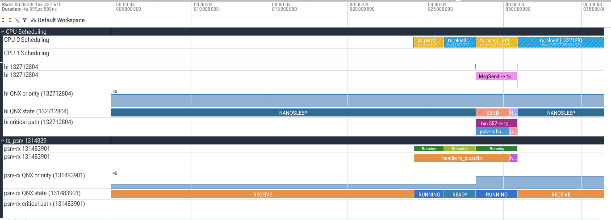
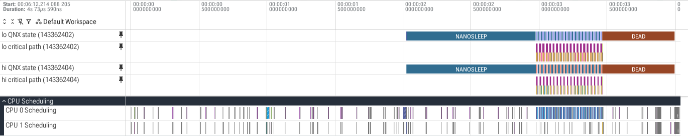

# trace-studio

trace-studio reads QNX OS 8.0 kernel event traces (`.kev` files written by `tracelogger`) on a development host, converts them to Perfetto traces, and analyses QNX message passing in them. It is for engineers who need to explain a deadline miss in a system built from communicating processes: which server a client waited for, what that server was doing, who held the CPU it needed, and whether the cause was a priority inversion.

The codelab [Find a priority inversion in QNX message passing](https://nikhil-qnx-codelabs.pages.dev/find-priority-inversion/) goes through the workflow in about 40 minutes: build a server and three clients, watch the high-priority client miss every deadline, capture a kernel trace, prove the inversion, fix it and prove the fix (source in [codelab/](codelab/find-priority-inversion.md), dry runs in [codelab/DRYRUN.md](codelab/DRYRUN.md)).

What it does:

- Reads `.kev` files directly with its own parser, so no QNX libraries are needed on the host. On the 17 x86_64 and 3 aarch64le captures listed below every event matches the SDP's `traceprinter` (timestamp, CPU, class, event), and so does every argument value both print, sign included.
- Converts to a Perfetto trace: per-CPU scheduling tracks, QNX thread states as the kernel reports them (SEND, RECEIVE, REPLY, MUTEX, ...), QNX priorities, the message exchanges it can link, each with the server's handling and the reply (joined by arrows when the exchange is trustworthy), resource-manager message names, pulses, interrupts, and a critical-path track per client thread. Names and paths that rest on a heuristic are labelled as candidates (`MsgSend _IO_READ (candidate) -> devb-eide`, argument `path_candidate`).
- `analyze`: latency per client and server, deadline misses, suspected priority inversions with the evidence, the critical path of a trustworthy request, and mutex waits with the owner and what it was doing, when the trace shows who the owner was.
- `diff`: before and after comparison of two traces.
- Keeps exchanges that cross lost events or carry contradictory kernel information, marks them `[not trustworthy]` and leaves them out of the analyses, with counts. A request with an ambiguous parent is kept in latency and left out of critical paths and inversions. Conclusions the trace cannot support are reported as "insufficient evidence", "not explained by the trace" or "unknown".

## Install

Python 3.10 or newer.

```
git clone https://github.com/NikhilGogu/qnx-trace-studio.git && cd qnx-trace-studio
python3 -m venv venv && venv/bin/pip install .
venv/bin/tracestudio --help
```

Dependencies: `perfetto` 0.59.x (its generated protobuf classes, and TraceProcessor for the tests) and `protobuf` 7.x. Only `convert` needs them at run time.

## Capture on QNX 8.0

Run `tracelogger` as root on the target. trace-studio needs all classes (thread states, process names, kernel calls, COMM, CONTROL), which is what non-daemon mode logs. Wide mode (`-w`) adds priorities, `_msg_info` and the first 12 bytes of each message, which the inversion analysis needs.

```
tracelogger -w -k 32 -b 128 -s 4 -f /tmp/trace.kev      # 4 seconds, wide mode
```

`-k 32` asks for 32 kernel buffers of 16 KB per CPU and `-b 128` for tracelogger-side buffers; with these, none of the captures below lost a buffer or dropped an event. Copy the file to the host (`scp target:/tmp/trace.kev .`).

The inversion analysis needs to know which CPUs the server may use. The trace records only run masks set while tracing (`ThreadCtl(_NTO_TCTL_RUNMASK)`); for a server whose mask was set before the trace started, the result is "insufficient evidence" unless you state the mask yourself with `analyze --runmask PROCESS[/THREAD]=MASK` or `--assume-unpinned PROCESS` (see Analyze).

The example traces were captured on QNX 8.0.0 x86_64 under QEMU/KVM (image built with `mkqnximage --type=qemu --arch=x86_64`, 2 CPUs, 1 GB); the aarch64le ones on a QEMU virt target under TCG (`mkqnximage --type=qemu --arch=aarch64le`, 2 CPUs), with `make -C workload ARCH=aarch64le` and `TS_SECONDS=12`. The workload in `workload/` (build with `source qnxsdp-env.sh && make -C workload`, which runs `qcc -Vgcc_ntox86_64`) and `workload/run_scenarios.sh` reproduce them:

```
sh run_scenarios.sh /tmp/ts/bin /tmp/ts/out prio_fixed prio_inherit
```

| scenario | what runs |
|---|---|
| `ipc_wide`, `ipc_fast` | ts_front (2 receive threads) forwards every fourth request to ts_back; 4 client threads, 40 requests each; pulses |
| `prio_fixed`, `prio_inherit` | on CPU 0: lo (prio 10) asks ts_psrv for 4 ms of work, hog (20) burns 10 ms, hi (30) asks for 0.5 ms with a 5 ms deadline; ts_psrv's channel with or without `_NTO_CHF_FIXED_PRIORITY` |
| `prio_fixed_rx`, `prio_inherit_rx` | as above, but the hog starts after ts_psrv already received hi's request |
| `cancel` | requests that end by TimerTimeout (ETIMEDOUT) or a signal (EINTR) while the server replies late |
| `rm_traffic`, `rm_small` | `ls`, `find`, `cat`, `dd`, `wc` on the qnx6 file systems served by devb-eide |
| `mutex_chain`, `mutex_chain_hog`, `mutex_chain_nopi` | ts_mutex on CPU 0: holder (prio 10) locks a mutex and, while it owns it, asks ts_mslow for 3 ms of work; mrx receives hi's (prio 30) request and blocks on that mutex; `_hog` adds a hog at 20; `_nopi` also creates the mutex with `PTHREAD_PRIO_NONE` |

Each workload process also writes a CSV log of what it did (ClockCycles(), ids, rcvids), which `tracestudio validate` compares with the decoded trace.

## Convert and open in Perfetto

```
tracestudio convert trace.kev                  # writes trace.perfetto-trace
```

Every command also reads gzip-compressed traces (`trace.kev.gz`), such as the captures in `tests/data`.

Open the output in https://ui.perfetto.dev ("Open trace file"). You can also query it with Perfetto SQL (`trace_processor_shell` or the `perfetto` Python package).

Each thread has its slice track (MsgSend, handle, MsgReply, pulses) and three child tracks: `QNX state` (the kernel's thread states, `qnx_prio` argument, UNKNOWN where data was lost), `QNX priority` (when it changes) and `critical path`. Every slice of an exchange (MsgSend, handle, MsgReply or MsgError, reply received) carries `txn`, `trustworthy` and any `warnings`; the MsgSend slice also has `rcvid`, `coid`, `message`, `path_candidate`, `client_qnx_prio`, `outcome` and `latency_us`. Click a slice to see them and follow its arrows. Arrows join only trustworthy exchanges; the slices of the others end in `[not trustworthy]`. Messages to procnto are named from its protocols (`_PROC_*`, `_IO_*`, ...). For other servers an `_IO_*` name needs a connection or channel that answered an `_IO_CONNECT` (type 0x100) in the trace; since an application message can use that number too, such names are labelled `(candidate)`, and other messages show their number (`type 0x0101`).

Screenshots from ui.perfetto.dev (traces from `tests/data`):

CPU 0 in `prio_fixed`: hog (hatched) holds the CPU while psrv-rx is preempted.


hi's `MsgSend -> ts_psrv` selected: the arrow lands on psrv-rx's handling of hi's request, which starts only after psrv-rx finishes lo's request.


The same period with all tracks: QNX states (SEND, READY, ...) and the critical-path tracks (`txn 522 -> ts_psrv: 11194.1 us`, `psrv-rx READY (10), CPU: hog (20) +4 more`).


With priority inheritance (`prio_inherit`), psrv-rx's QNX priority rises from 10 to 30 the moment hi sends, while psrv-rx still handles lo's request; it then preempts hog.



Resource-manager traffic (`rm_small`): `cat`'s `MsgSend _IO_READ (candidate) -> devb-eide` with its arrow to devb-eide's `fsys_resmgr` thread, and its arguments (`path_candidate` is the path the coid was probably opened with).


## Open in Perfetto with one command

```
tracestudio open prio_fixed.kev                      # converts once, then opens ui.perfetto.dev with the trace loaded
tracestudio open prio_fixed.kev --no-browser         # on a build box: prints the URL and an ssh port-forward line
tracestudio open ipc_wide.kev --pin '^front-rx0 ' --pin 'CPU 0'
```

`open` converts the trace into a private cache (`~/.cache/tracestudio`, mode 0700; written atomically and reused only when the file is complete and was converted from the same input by the same version), serves it on 127.0.0.1 only under a random per-run token (requests must name 127.0.0.1 or localhost on that port as Host, and the completion report must come from the page's own origin) and opens that page in the default browser. The page opens ui.perfetto.dev and hands it the trace with Perfetto's documented postMessage protocol: it sends `PING` until the UI answers `PONG`, then `{perfetto: {buffer, title, fileName}}`. The UI URL carries `startupCommands` with `dev.perfetto.PinTracksByRegex`, which pins tracks at the top: by default the critical-path and QNX state tracks of the clients that missed `--deadline THREAD=US`, else of the two clients with the slowest trustworthy MsgSend to a server other than procnto; `--pin REGEX` (repeatable, matched against track names) replaces them. The command stops once the page reports that it handed the trace to the UI (postMessage cannot confirm that the UI loaded it), at `--timeout`, or on Ctrl-C. If the browser blocks the Perfetto window, the page shows a button that opens it; HTTP and network errors, a closed Perfetto window and a UI that does not answer within 60 s are shown on the page with a Retry button.

On a remote build box, use `--no-browser` and forward the port (output of the run checked in headless Chromium; user, host, cache key and token replaced):

```
$ tracestudio open prio_fixed.kev --no-browser
converted prio_fixed.kev -> ~/.cache/tracestudio/<key>.perfetto-trace
serving ~/.cache/tracestudio/<key>.perfetto-trace (2733245 bytes) at http://127.0.0.1:8765/<token>/ (this machine only)
pinning tracks matching ^lo (critical path|QNX state), ^hi (critical path|QNX state) (clients ts_pload/lo, ts_pload/hi)
open http://127.0.0.1:8765/<token>/ in a browser on this machine; from another machine, forward the port first:
  ssh -N -L 8765:127.0.0.1:8765 <user>@<build box>     then open the same URL there
waiting for the browser (Ctrl-C to stop) ...
trace handed to Perfetto (2733245 bytes); the UI loads it in its tab
```

What ui.perfetto.dev (v59.1) showed after that session: lo's and hi's QNX state and critical-path tracks pinned above the CPU tracks.



## Analyze

```
tracestudio analyze prio_fixed.kev --deadline hi=5000
```

prints latency per client and server, deadline misses, suspected inversions and fixed-priority channels (abridged, long lines wrapped):

```
trace prio_fixed.kev: 690 message exchanges, 682 trustworthy (analyses use only those)
  10 of them have an ambiguous parent: kept in latency, left out of critical paths and inversions
deadline hi=5000 us on ts_psrv: 20 of 20 requests missed, max 11429.5 us
suspected priority inversions: 20 (checked 672 exchanges, 5 excluded as untrustworthy, 10 with an ambiguous
  parent, threshold 100 us)
  txn 520: ts_pload/hi (prio 30) waited 10937.8 us in MsgSend; for 8151.9 us of it (SEND-blocked 8151.9 us)
  ts_psrv/psrv-rx was READY at prio 10 while every CPU it may run on (CPU 0, run mask 0x1) ran a thread above
  prio 10, at least one of them below the client's 30; most of the time ts_pload/hog (prio 20) on CPU 0,
  8151.9 us; the server was busy with ts_pload/lo's request (txn 519).
insufficient evidence (the trace cannot show whether the server was held up): 2
  txn 94: ts_psrv/psrv-rx -> procnto-smp-instr/proc_pool_thread, 1146.3 us unexplained: request handed off:
  received by procnto-smp-instr/proc_pool_thread (tid 14), replied by procnto-smp-instr/proc_pool_thread (tid 16)
  ...
channels created with _NTO_CHF_FIXED_PRIORITY: ts_psrv chid 1
```

A suspected inversion needs evidence for every instant it counts: the client SEND- or REPLY-blocked on the server thread; the server READY at a lower priority than the client (priorities as known at that instant); the server's run mask traced and not invalidated since; every CPU in that mask busy with threads above the server, at least one of them below the client. While the client is SEND-blocked the server thread must also be provably the only thread of its process (a complete thread inventory with lifetimes, and no lost events), since another thread could receive the message; for multi-threaded servers the SEND phase is therefore always insufficient evidence. When another thread replies, the REPLY phase is insufficient evidence too: the trace does not say which threads worked on the request. When the trace cannot show why a low-priority server was not running (untraced run mask, idle CPU, lost events, other possible receivers, a handoff, sporadic scheduling, adaptive partitioning), the request is reported as "insufficient evidence" with the reasons. `--json` prints all rows, including all inversions. `--deadline THREAD@SERVER=US` counts only the requests to that server process (`hi@ts_psrv=5000`); `THREAD=US` counts all of the thread's requests.

Run masks set before the trace started are not in it. If you know one from the program's code or configuration, say so: `--runmask ts_psrv/psrv-rx=0x1` (repeatable, hex, thread name optional) or `--assume-unpinned ts_psrv` (every CPU). A supplied mask applies to a thread only until the trace shows a mask event for it and only before the first lost events; every verdict that uses one says so in its evidence ("Relies on run mask 0x1 supplied by --runmask."), and `analyze` and `diff` count those verdicts separately.

## Critical path

```
tracestudio analyze prio_fixed.kev --request 524     # the txn argument shown in Perfetto
tracestudio analyze trace.kev --slowest 5            # the 5 slowest top-level requests
```

partitions the client's MsgSend latency into consecutive segments that add up exactly, recursing into trustworthy requests the server sends to other servers:

```
txn 524: ts_pload/hi -> ts_psrv, MsgSend latency 11429.5 us
   start us       us      %  what
      0.0      0.5    0.0  ts_pload/hi running
      0.5   8143.0   71.2  ts_psrv/psrv-rx READY at prio 10, CPUs held by ts_pload/hog (prio 20) on CPU 0 8142.8 us, ...
   8143.5    789.7    6.9  ts_psrv/psrv-rx running ts_pload/lo's request (txn 523)
   ...
  10896.4      1.4    0.0  ts_psrv/psrv-rx running, not in a request
  10897.8      0.4    0.0  ts_psrv/psrv-rx receiving this request (in MsgReceivev)
  10898.1    530.0    4.6  ts_psrv/psrv-rx running this request
  11428.1      0.4    0.0  ts_psrv/psrv-rx replying
  11428.5      0.5    0.0  ts_pload/hi READY at prio 30, not explained by the trace: CPU 0 ran ts_psrv/psrv-rx (prio 10) 0.5 us
   by kind: server preempted 8702.3 us, server busy 2194.9 us, server running 530.7 us, client running 1.1 us, unexplained ready 0.5 us
```

A forwarded request (`ipc_wide`, txn 975) shows the nested server inline, and a wait the trace cannot explain as such:

```
    110.2    209.8   37.9  ts_front/front-rx0 waits for ts_back (txn 977)
    110.8    208.4   37.6    ts_back/back-rx running this request
    320.0     47.0    8.5  ts_front/front-rx0 READY at prio 10, not explained by the trace: CPU 0 idle (no run mask traced) 47.0 us
```

Segment kinds: client running, client ready, server waiting, server busy (with another request, holding several, or running outside any request), server preempted, server running (inside the MsgReceivev call that returned the request, handling it, replying), nested request, server blocked, unexplained ready, unknown (lost events, or a handoff: another thread replied, or the receiver went back to MsgReceive with the request open). A wait is "preempted" or "ready" only when every CPU the thread may use ran a known thread at or above its priority. `convert` writes the same segments to each client thread's `critical path` track.

## Mutex owner chains

QNX mutexes are locked and unlocked in user space while nobody waits; the kernel, and so the trace, sees a mutex only when a thread has to wait (SyncMutexLock) and when its owner releases it to a waiter (SyncMutexUnlock). Both calls carry the mutex address and the owner word the kernel read (SAT layouts, checked against traceprinter). The owner of a blocked SyncMutexLock is known only when a SyncMutexUnlock of the same mutex (same process, same address) that carries the owner value the waiter's call read exits successfully, the unlocking thread existed without dying from the waiter's read to its unlock (owner values are unique only among live threads), and no events were lost in between; that thread then owned the mutex from the waiter's call to its unlock. Otherwise the owner is reported as unknown, with the reason: another owner value at the unlock, an owner word that names no thread (0, or the markers from 0xffffff00 up), a recursive mutex (unsupported), the mutex destroyed or created again at that address, lost events, no successful unlock seen, the previous owner died (EOWNERDEAD, which still counts as acquiring the mutex), or still waiting when the trace ended.

With a known owner, the critical path of a request whose server thread waits on the mutex follows the owner up to its unlock: owner running, owner preempted (READY behind threads at or above its priority), owner blocked, or the owner's own trustworthy request nested inside (never the same request twice on one path). `analyze` lists the mutex waits of at least `--min-us` with the owner, the priorities it was seen at before and during the wait and what it did meanwhile, then any MUTEX time after the owner's unlock (the next owner is not traced) and the time until SyncMutexLock returned. Perfetto splits the waiting thread's slice the same way: `MUTEX 0x... (owner holder)`, `(owner not traced after the release)`, `woken, until SyncMutexLock returns`.

The slowest of hi's requests in `mutex_chain_nopi` (no priority inheritance, a hog at 20), abridged:

```
$ tracestudio analyze mutex_chain_nopi.kev.gz --slowest 1 --client ts_mutex/hi
txn 520: ts_mutex/hi -> ts_mutex, MsgSend latency 7777.6 us
   start us       us      %  what
      6.3   7562.3   97.2  ts_mutex/mrx MUTEX-blocked on mutex 0x4f2f5f9020 owned by ts_mutex/holder, which waits for
                           ts_mslow (txn 519)
      6.5    934.5   12.0    ts_mslow/slow-rx running this request
    941.0   5218.8   67.1    ts_mslow/slow-rx READY at prio 10, CPUs held by ts_mutex/hog (prio 20) on CPU 0 5182.7 us, ...
   6159.8   1407.9   18.1    ts_mslow/slow-rx running this request
   ...
```

With QNX's default priority inheritance (`mutex_chain_hog`), the holder is seen at priority 30 while it owns the mutex (at 10 in `mutex_chain_nopi`), and so is ts_mslow's server thread while it handles the holder's request; the hog does not get in and the waits are about 2.4 ms:

```
$ tracestudio analyze mutex_chain_hog.kev.gz --top 1
...
mutex waits of at least 100 us: 20 (owner known for 20)
  wait 18: ts_mutex/mrx (prio 30) MUTEX-blocked 2418.2 us on mutex 0x1740110020 owned by ts_mutex/holder (prio 10
  before the wait, up to 30 during it) for 2417.4 us of it, which was REPLY-blocked on ts_mslow (txn 559) 2414.1 us,
  RUNNING 2.0 us, READY 1.3 us; then 0.8 us MUTEX-blocked with the next owner not traced; then 0.9 us before
  SyncMutexLock returned
```

## Diff

```
tracestudio diff prio_fixed.kev prio_inherit.kev --deadline hi=5000 --client ts_pload/hi
```

```
deadline hi=5000 us on ts_psrv: before 20/20 missed, max 11429.5 us | after 0/20 missed, max 2740.4 us
suspected priority inversions: before 20 | after 0 (checked 21 | 21 exchanges; insufficient evidence: 0 | 0; relying
  on supplied run masks: 0 | 0)
fixed-priority channels: before ts_psrv chid 1 | after none
MsgSend latency (us) by client@priority -> server: 2 pairs compared (trustworthy requests on both sides), 0 without
  trustworthy requests on a side, 0 only before, 0 only after
largest p99 change:
  client@priority                server                      n       p50       p90       p99       max  excluded/unfinished
  ts_pload/hi@30                 ts_psrv          before    20   10883.2   11141.9   11429.5   11429.5  0/0
  ts_pload/hi@30                 ts_psrv          after     20    2686.6    2725.9    2740.4    2740.4  0/0
  ...
server priority while handling each client's request (share of the server's running time, changes of 1 point or more):
  ts_psrv/psrv-rx for ts_pload/hi: before prio 10 100% | after prio 30 100%
```

Rows are matched by role (client process, thread name and priority, server process). Only pairs with trustworthy requests on both sides are ranked; pairs whose requests were all excluded or unfinished on one side, and roles found only before or only after, are listed separately. Priority shares are compared from unrounded running time. Server running time while it holds several requests is counted once, under "(several requests open)". `--client` filters every per-client part of `analyze` and `diff` (latency rows, deadlines, inversions, server priority), in text and in `--json` output.

Other commands: `tracestudio info trace.kev` (header, losses, decoder counters as JSON) and `tracestudio validate trace.kev --logs DIR` (ground-truth check against the logs of the `ipc_*` and `prio_*` workloads). validate exits with status 1 when a logged SEND or DONE record has no partner, a logged request matches no decoded exchange or the same one as another request, any check disagrees or has no decoded value (client and server thread, rcvid, coid, MsgSend outcome, timing against the logs, the request id in wide mode, the parent of a forwarded request), or the pulse counts differ from the log (receives always, values in wide mode).

## Check real-time budgets in CI

```
tracestudio check prio_fixed.kev --deadline hi@ts_psrv=5000 --no-inversions --client ts_pload/ --junit report.xml
```

`check` evaluates assertions with the analyses behind `analyze`, on trustworthy exchanges only, prints one PASS or FAIL line per assertion with its numbers (and the evidence of a failure), and exits with status 0 when all pass, 1 when any fails or the trace cannot be read, and 2 on usage errors. Assertions:

- `--deadline THREAD[@SERVER]=US`: every MsgSend of the client threads with that name (to that server process only, with `@SERVER`) ends within US microseconds; `--max-latency CLIENT[@SERVER]=US` does the same for client threads whose label contains CLIENT. Each needs at least `--min-requests` trustworthy requests (default 1) and reports the roles it matched (`matched ts_pload/hi@30 -> ts_psrv (20)`).
- `--no-inversions`: no suspected priority inversion, at least `--min-checked` exchanges (default 1) checked by the inversion analysis, and no more than `--max-insufficient` (default 0) requests with insufficient evidence; the line reports the checked, inconclusive, excluded and ambiguous-parent counts. `--client TEXT` limits this analysis to the client threads the gate is about, as for `analyze`. `--max-insufficient N` without `--no-inversions` is an assertion of its own.

`--runmask`, `--assume-unpinned` and `--min-us` work as for `analyze`. A trace that lost events fails its `trace integrity` assertion, and a latency assertion whose requests include excluded or unfinished ones fails, unless `--allow-loss` is given (they are still reported). `--junit FILE` also writes a JUnit XML report: a `testsuite` with one `testcase` per assertion and a `failure` element with the evidence for each one that failed; it is written atomically, characters XML cannot carry are replaced, and a trace that cannot be read gives a report with one `error` testcase.

`tools/ci_qemu_check.sh SCENARIO [check options]` is a CI job for a runner with the SDP and KVM: it builds the workload with the SDP, boots a fresh QEMU target with mkqnximage, runs the scenario under tracelogger, fetches the `.kev` and runs `tracestudio check`. A trap stops the target on every way out (success, a failed step, SIGINT, SIGTERM) and keeps the exit status: check's, or that of the step that failed. These are the commands it ran on the build box (from its `set -x` trace; `$SSHO` holds the ssh options, `$IP` the target address):

```
source ~/qnx800/qnxsdp-env.sh
make -C ~/work/trace-studio/workload                    # qcc -Vgcc_ntox86_64 ... -o build/x86_64/ts_* (6 programs)
python3 -m venv ~/work/ts-ci/prio_fixed/venv
~/work/ts-ci/prio_fixed/venv/bin/pip install -q ~/work/trace-studio
cd ~/work/ts-ci/prio_fixed/target
mkqnximage --type=qemu --arch=x86_64 --ssh-ident=~/.ssh/id_ed25519.pub --noprompt --run=-h
IP=$(mkqnximage --getip | tail -1)
ssh $SSHO root@$IP true                                  # repeated until the target answers
ssh $SSHO root@$IP mkdir -p /tmp/ts/bin
scp -q $SSHO ~/work/trace-studio/workload/build/x86_64/ts_* ~/work/trace-studio/workload/run_scenarios.sh root@$IP:/tmp/ts/bin/
ssh $SSHO root@$IP sh /tmp/ts/bin/run_scenarios.sh /tmp/ts/bin /tmp/ts/out prio_fixed
scp -q $SSHO root@$IP:/tmp/ts/out/prio_fixed.kev ~/work/ts-ci/prio_fixed/
~/work/ts-ci/prio_fixed/venv/bin/tracestudio check ~/work/ts-ci/prio_fixed/prio_fixed.kev --junit ~/work/ts-ci/prio_fixed/prio_fixed.junit.xml --deadline hi@ts_psrv=5000 --no-inversions --client ts_pload/
mkqnximage --stop                                        # in the exit trap
```

The failing run (fixed-priority channel), output abridged:

```
$ CI_WORK=~/work/ts-ci/prio_fixed tools/ci_qemu_check.sh prio_fixed --deadline hi@ts_psrv=5000 --no-inversions --client ts_pload/; echo "exit $?"
...
hi: 20 of 20 requests missed the 5000 us deadline, slowest 11112 us              (ts_pload's own log, on the target)
prio_fixed: 836725 bytes, logs: pload-679960.csv psrv_fixed-667671.csv
PASS trace integrity: no lost events, 676 of 686 message exchanges trustworthy
FAIL deadline hi@ts_psrv=5000 us: 20 of 20 trustworthy requests over 5000 us, max 11096.0 us; matched ts_pload/hi@30 ->
  ts_psrv (20)
  txn 482: ts_pload/hi -> ts_psrv, 11096.0 us (budget 5000 us)
  ...
FAIL no suspected priority inversions: 20 suspected; checked 119 exchanges of clients matching 'ts_pload/' (at least 1
  required), 0 with insufficient evidence (at most 0 allowed), 0 excluded as untrustworthy, 0 with an ambiguous parent
  txn 476: ts_pload/hi (prio 30) waited 10908.4 us in MsgSend; for 8186.7 us of it (SEND-blocked 8186.7 us)
  ts_psrv/psrv-rx was READY at prio 10 while every CPU it may run on (CPU 0, run mask 0x1) ran a thread above prio 10, ...
  ...
check: 3 assertions, 2 failed
wrote ~/work/ts-ci/prio_fixed/prio_fixed.junit.xml
exit 1
```

The passing run (priority inheritance):

```
$ CI_WORK=~/work/ts-ci/prio_inherit tools/ci_qemu_check.sh prio_inherit --deadline hi@ts_psrv=5000 --no-inversions --client ts_pload/; echo "exit $?"
...
hi: 0 of 20 requests missed the 5000 us deadline, slowest 2794 us
prio_inherit: 841741 bytes, logs: pload-679960.csv psrv_inherit-667671.csv
PASS trace integrity: no lost events, 676 of 685 message exchanges trustworthy
PASS deadline hi@ts_psrv=5000 us: 0 of 20 trustworthy requests over 5000 us, max 2779.0 us; matched ts_pload/hi@30 ->
  ts_psrv (20)
PASS no suspected priority inversions: 0 suspected; checked 119 exchanges of clients matching 'ts_pload/' (at least 1
  required), 0 with insufficient evidence (at most 0 allowed), 0 excluded as untrustworthy, 0 with an ambiguous parent
check: 3 assertions, 0 failed
wrote ~/work/ts-ci/prio_inherit/prio_inherit.junit.xml
exit 0
```

The JUnit report of the failing run starts like this:

```
<testsuites name="tracestudio check" tests="3" failures="2" errors="0" time="0.154">
  <testsuite name="tracestudio check prio_fixed" tests="3" failures="2" errors="0" skipped="0" time="0.154" ...>
    ...
    <testcase classname="tracestudio.check.prio_fixed" name="deadline hi@ts_psrv=5000 us" time="0">
      <failure message="20 of 20 trustworthy requests over 5000 us, max 11096.0 us; matched ..." type="DeadlineMissed">
```

Without `--client`, the same passing capture failed `--no-inversions`: one request from ts_psrv itself to procnto had insufficient evidence (procnto received it on one thread and replied on another), and the default allows none. The workload's own measurement (11112 us) is about 15 us longer than the traced MsgSend.

## Support matrix

| | status |
|---|---|
| QNX SDP 8.0.0, x86_64, QEMU/KVM, 2 CPUs | verified on 17 captures |
| tracelogger wide mode (`-w`) | verified |
| fast mode | verified for message linking and message names (msg[0] keeps the `_IO_CONNECT` subtype); no priorities, so no inversion analysis |
| per-class mix of fast and wide events | unit tests only |
| aarch64le, QEMU virt (TCG), 2 CPUs | verified on 3 captures (`ipc_wide`, `prio_fixed`, `prio_inherit`, wide mode; Cortex-A57, ClockCycles at 62.5 MHz): events and arguments identical to traceprinter, all logged requests and pulses matched, the same priority results as on x86_64; real aarch64 hardware untested |
| more than 2 CPUs, real hardware | untested |
| mutex owners (SyncMutexLock/SyncMutexUnlock) | verified on 3 captures (60 waits against the workload's logs); mutexes shared between processes give "owner unknown" |
| big-endian traces | not supported (refused) |
| lost buffers, buffers missing slots, DROPPED events, truncated files | unit tests and fault injection; no capture with real loss yet |
| interrupted kernel calls (INT_CALL) | bit 8 of the event code, no arguments, as the SAT guide says and as traceprinter prints a synthetic event; never seen in a capture (timeouts and signals ended MsgSend with KER_EXIT, return code -1 and errno) |
| adaptive partitioning, sporadic scheduling, QVM guests | untested; inversion analysis reports insufficient evidence when they appear |
| Python 3.10 and 3.12 | verified (`pip install .` in fresh venvs, test suite) |
| Perfetto UI | checked in ui.perfetto.dev (screenshots taken 3 Nov 2026) |

## Validation evidence

The measurements were made on the build box (Ubuntu 22.04, QNX SDP 8.0) against the 17 x86_64 and 3 aarch64le captures from the QEMU targets described above.

- Parser against `traceprinter` (`tools/compare_traceprinter.py`, exact values), 17 captures: 739,841 events identical in timestamp, CPU, class and event; 2,428,184 argument values compared, 0 mismatches, sign included. They are the arguments of 70 event kinds (235 event and field pairs): thread states (pid, tid, priority, policy), process creation, destruction and names, PATHMGR and TIMER system events, interrupts, CONTROL/TIME, the COMM events, the entries and exits of MsgSendv, MsgSendvnc, MsgReceivev, MsgReceivePulsev, MsgReplyv, MsgError, MsgSendPulse, ChannelCreate, ConnectAttach, ConnectDetach, ThreadCtl, ThreadCtlExt, SchedSet, SyncMutexLock, SyncMutexUnlock and SyncTypeCreate, and the return code and errno of every failed kernel call. Not compared: 388,758 values of 304 kinds that traceprinter prints and trace-studio does not decode (the arguments of the other kernel calls, such as the other SYNC_*, TIMER_* and CONNECT_*_INFO calls and MsgReadv/MsgWritev, `_msg_info` fields it skips, and MMAP events; 69,108 of these events have no decoded argument at all), and 9,085 decoded values traceprinter does not print in a comparable form (CONTROL/BUFFER counts, MsgSendvnc exit status, COMM SIGNAL, a few message words). The largest capture (`rm_traffic`, 12.4 MB) has 306,436 events. The layouts of failed exits, INT_CALL, the signed 64-bit counts, MsgSendPulsePtr and the mutex calls were also checked against traceprinter on a synthetic trace (a unit test does this when traceprinter is installed).
- aarch64le (QEMU virt under TCG, 2 CPUs, ClockCycles at 62.5 MHz; 3 captures): 158,352 events identical to traceprinter and 487,334 argument values compared, 0 mismatches; 280 of 280 logged requests matched (200 in `ipc_wide` with 4 of 4 client pulses and 425 of 425 timer pulses, 40 in each `prio_*`); `prio_fixed` has 20 suspected inversions (SEND-blocked, median 9.9 ms of evidence, run mask 0x1, hog at 20 on CPU 0) and 20 of 20 deadline misses at 5 ms (max 14816.9 us), `prio_inherit` none and 0 of 20 (max 4116.2 us); `tracestudio check --deadline hi@ts_psrv=5000 --no-inversions --client ts_pload/` exits 1 and 0; TraceProcessor imports all three without errors.
- Message linking against the workload's own logs (`tracestudio validate`): 1,100 of 1,100 logged requests matched to the right client thread, server thread, rcvid, coid and MsgSend outcome (480 in run 1, 480 in run 2, 80 in run 3, 60 in the mutex captures), every SEND and DONE record paired, including all 160 forwarded requests of runs 1 and 2 linked to their parent, with rcvids reused up to 186 times; the pulse counts of the 4 `ipc_*` captures agree with the logs. Mutexes: all 60 of mrx's waits in the three mutex captures match the logs (mutex address, owner thread, owner value as the holder's TLS `__owner`, release between the holder's UNLOCK and mrx's ACQUIRED logs, and the holder's decoded request to ts_mslow).
- Inversions: 20 of 20 hi requests flagged with a fixed-priority channel and 0 with inheritance, both when the hog strikes before the receive (`prio_fixed`, median 8.2 ms of evidence each, SEND-blocked) and after it (`prio_fixed_rx`, median 10.0 ms, REPLY-blocked); 0 in the wide-mode IPC capture. Requests that procnto received on one thread and replied to on another are reported as insufficient evidence: 2 in `prio_fixed`, 2 in `prio_inherit`, 1 in `prio_inherit_rx`, 2 in `ipc_wide`. Fast mode records no priorities, so `ipc_fast` has no inversions and 15 requests with insufficient evidence (12 for the missing priorities, 3 handoffs). Deadline misses at 5 ms: 20/20 versus 0/20 in both pairs.
- Cancellation (`cancel`, checked by the regression test `test_cancellation_matches_the_workload_log`; validate does not cover this workload): all 15 logged sends decoded with the logged outcome (5 replied, 10 cancelled with return code -1 and the logged errno, ETIMEDOUT or EINTR), and the 10 late MsgReply calls that failed in the log are exactly the 10 replies the decoder could not attach to any exchange.
- Resource managers: summing the bytes of `cat`'s `_IO_READ` replies per candidate path gives 26 paths in `rm_traffic`: 25 equal the file size (`wc -c` on the target) and `librcheck.so.1` has twice its size, because `cat` also read it through the symlink `librcheck.so`; both files in `rm_small` match. In `rm_traffic` 7,293 `_IO_*` names are candidates (servers other than procnto), and 90 messages with an `_IO_*` number on connections with no `_IO_CONNECT` evidence are left unnamed.
- Fault injection (`tools/drop_buffer.py`): removing 4 of the 15 kernel buffers inside the workload window of `ipc_wide` leaves 108 of 200 requests matched, 62 without a candidate, no wrong link in that test (server, rcvid, coid, request id, parent); 2 outcomes contradict the log, both on exchanges flagged untrustworthy, and the pulse counts differ, so validation fails.
- Perfetto import: TraceProcessor 0.59.1 loads all 14 converted captures with no error or data-loss stats; every flow joins slices of one transaction; no slice has a negative duration.
- Tests: `python3 tests/test_tracestudio.py` (or pytest) runs 82 tests: 68 on synthetic slot streams (one checks that gzip-compressed traces read like plain ones), including a counterexample for each finding of the second, third and fourth reviews (among them: deleted middle slots, a partial final slot, losses at trace start, unanchored timestamps, READY inside a loss window, untraced and supplied run masks, inheriting channels, stale channel identities after a loss, other possible receivers, reused thread ids, sporadic scheduling, clipped attribution, untrustworthy children, receive attribution, cross-thread replies, stale replies, ambiguous parents, wakeups across a re-block, pulse queues out of sync, candidate paths and names, untrustworthy exchanges without arrows, failed kernel-call exits, INT_CALL, signed 64-bit and `_msg_info` fields, MsgSendPulsePtr, unpaired and shared log records, wrong coid, outcome and pulse counts, diff rows without samples and changed priority shares, non-finite or negative numbers, unreadable input and short CSV records, `open`'s page, protocol, Host, token and Origin checks and private cache, `check` on lost events, empty assertions, inversion coverage, server-scoped deadlines and JUnit edge cases), and 14 on the captures in `tests/data` (including the two mutex captures with a tampered-log counterexample, an aarch64le capture, CLI exit codes, `check` on `prio_fixed` and `prio_inherit` with their JUnit reports, and `open`'s cache and default pins). With `TS_REQUIRE_ALL=1` a missing `traceprinter` or perfetto package fails the run; all 82 pass that way on the build box.
- Packaging: a wheel and an sdist built with `python -m build` install in fresh venvs and run on Python 3.10 (build box) and 3.12 (development host). The sdist carries the test files but not `tests/kevgen.py` or the fixtures; run the tests from the repository.
- Speed on the build box: `ipc_wide` (1.7 MB, 44,807 events) converts in 0.87 s with 103 MB peak memory; `rm_traffic` in 7.5 s with 734 MB; `analyze` takes 0.37 s and 2.8 s.

## Limitations

- The thread that runs a kernel call is inferred as the last thread switched in on that CPU; the inference held for every logged request. Inside loss windows and after a migration the thread is "unknown" until the next switch.
- Fast-mode traces carry no priorities, `_msg_info` or message payload beyond msg[0]: no inversion analysis and no pulse values.
- Wakeups appear in Perfetto ("woken by") only with object evidence: the woken thread receives the message or pulse sent in the waker's kernel call before it blocks again, or the waker's reply names it. Timer, interrupt, synchronisation-object and cross-CPU wakeups have no waker; the QNX state track still shows READY.
- Perfetto's own thread-state view maps QNX states to Linux ones (blocked states become "Sleeping"); the `QNX state` track has the kernel's states.
- The priority column of Perfetto's sched table holds the QNX priority (0 to 255, higher wins).
- The inversion analysis needs the server's run mask traced (`ThreadCtl` during the trace) or supplied with `--runmask`; SEND-phase verdicts need a single-threaded server process, so for multi-threaded servers they are always "insufficient evidence"; requests replied to by another thread are "insufficient evidence" after the receive; it is one level deep (it does not chain through a server that is itself blocked on another server or a mutex).
- The critical path follows trustworthy nested requests and mutex owners when the trace shows them. It does not follow condvars, semaphores, rwlocks or handoffs to other threads (it says "handed off, not followed" and counts that time as unknown).
- A server holding several received requests is reported as such, since the trace does not say which one it works on.
- Mutex owners are known only for contended mutexes (uncontended locks never reach the kernel), only from the waiter's SyncMutexLock until the owner's successful SyncMutexUnlock (after that, when several threads waited, the next owner is not traced), only within one process (the address of a mutex shared between processes differs per process), and not for recursive mutexes. Remapping the memory of a mutex is not traced in a form trace-studio decodes; an owner is never carried from one wait to another, so a reused address can only matter within a single wait.
- Paths are candidates: a coid gets one when the opening thread's PATHMGR event is followed within 10 ms by its ConnectAttach and the first message on the coid is an `_IO_CONNECT` answered without error. Nothing in the trace ties the PATHMGR lookup to that connection, so an unrelated open in the window would inherit the path. Files opened before the trace started have no path.
- Pulses are linked only when exactly one send can match a receive on a queue that is in sync (the receiver blocked on the channel that the scoid's pulses arrive on, with that channel learnt again after any loss, and no ambiguous receive since); otherwise the candidates are recorded and no arrow is drawn.
- In the pinned priority runs the workload's own ClockCycles() is about 15 us before the traced MsgSendv entry; the cause is not known.

## Licence

Apache-2.0, see `LICENSE`.
