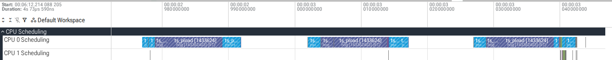
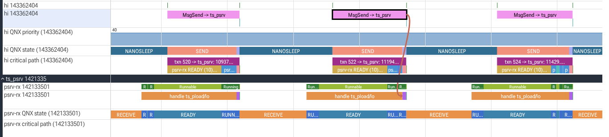
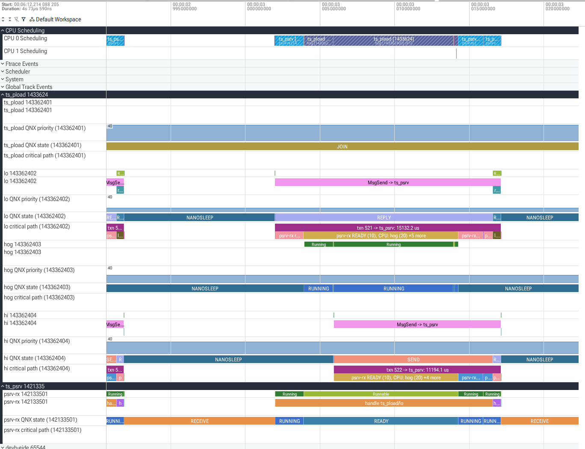
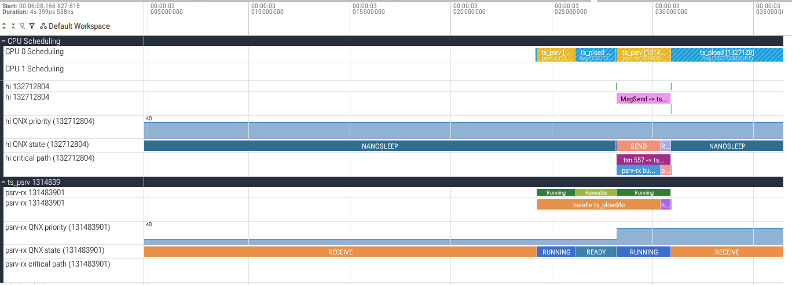

id: find-priority-inversion
title: Find a priority inversion in QNX message passing
summary: Run a QNX OS 8.0 server and three clients in which the highest-priority client misses every deadline, capture a kernel trace with tracelogger, prove the priority inversion from the trace with trace-studio and Perfetto, then fix the server and prove the fix.
categories: qnx, real-time, codelabs
tags: intermediate
difficulty: 3
status: published
authors: Nikhil Reddy Gogu, Yashaswin Puranik
feedback_link: https://github.com/NikhilGogu/qnx-trace-studio/issues


# Find a priority inversion in QNX message passing

## What you will learn
Duration: 2:00

On QNX OS, a client that calls `MsgSend()` stays blocked until the server replies, so the client's response time depends on when the server gets the CPU. QNX gives the server thread that handles a message the priority of the thread that sent it. This is message-driven priority inheritance. A channel created with `_NTO_CHF_FIXED_PRIORITY` turns it off, and then any thread whose priority lies between the server's and the client's can hold the client up. That is a priority inversion.

In this codelab you run a small server and three clients on a QNX OS 8.0 virtual machine, see the highest-priority client miss 20 of 20 deadlines, and find out why from a kernel event trace instead of guessing. Then you change one flag, trace again and show that the inversion is gone.

**What you will do:**

* Start a QNX OS 8.0 target in QEMU with mkqnximage
* Build the server and the clients with qcc and run them
* Capture a kernel event trace with tracelogger in wide mode
* Convert the trace with trace-studio and read it in Perfetto: QNX thread states, priorities and message arrows
* Get the evidence for the inversion and the critical path of the slowest request
* Fix the server, capture again and compare the two traces

**What you will learn about QNX:** how `MsgSend()` passes the client's priority to the server and at which moment, what `_NTO_CHF_FIXED_PRIORITY` changes, what tracelogger's options do and why the analysis needs wide mode, and how a trace tells an inversion apart from ordinary preemption.

trace-studio is an open-source (Apache-2.0) command-line tool that reads the `.kev` files tracelogger writes, on your development host, without QNX libraries. It converts them to Perfetto traces and analyses the message passing in them.

Everything in this codelab was run as written on Ubuntu 22.04 with QNX SDP 8.0. The outputs are real, from that run, and trimmed: lines that do not matter here are replaced by `...`, long lines are wrapped and wide tables narrowed. Your process ids, transaction numbers and times will differ.

---

## Before you begin
Duration: 4:00

You need:

1. **QNX SDP 8.0 with a free non-commercial licence.** If you do not have one yet, follow the QNX codelab [Get a Free Non-Commercial QNX 8.0 License](https://qnx.github.io/codelabs/get-non-commercial-qnx-license/), then install QNX SDP 8.0 with the QNX Software Center. This codelab assumes it is installed in `~/qnx800` (the Software Center default), so that `~/qnx800/qnxsdp-env.sh` exists.
2. **Ubuntu (22.04 or later, x86_64) with KVM and QEMU.** Your user must be able to use `/dev/kvm`, and the default libvirt network must be up, because mkqnximage targets get their address from it:

    ```bash
    sudo apt install qemu-system-x86 libvirt-daemon-system bridge-utils \
        python3-venv git openssh-client
    sudo adduser $USER kvm
    sudo adduser $USER libvirt
    ```

    Log out and in again after `adduser`. Then check the network and let mkqnximage's own script allow QEMU to use libvirt's `virbr0` bridge:

    ```bash
    virsh -c qemu:///system net-list
    ~/qnx800/host/common/mkqnximage/qemu/check-net
    ```

    `virsh` should list `default` as `active`. `check-net` prints nothing when QEMU may already use `virbr0`; otherwise it asks once for your sudo password to make `qemu-bridge-helper` setuid root and add `allow virbr0` to QEMU's `bridge.conf`.
3. **Python 3.10 or later** (`python3 --version`).
4. **An SSH key without a passphrase** at `~/.ssh/id_ed25519`. mkqnximage installs its public half for root on the target. If you have none: `ssh-keygen -q -t ed25519 -N '' -f ~/.ssh/id_ed25519`.
5. **A web browser** for [ui.perfetto.dev](https://ui.perfetto.dev). Perfetto opens the trace inside the page; the file stays on your machine.

You do not need to know Perfetto. You should be able to read C.

---

## Start a QNX target
Duration: 3:00

Everything this codelab creates lives under one directory, so you can remove it in one step at the end. Open a terminal and keep it open for the whole codelab: later steps use the variables you set here.

Create the directory, load the SDP environment and build and boot a QNX OS 8.0 image:

```bash
export CODELAB=$HOME/trace-codelab
mkdir -p $CODELAB/target && cd $CODELAB/target
source ~/qnx800/qnxsdp-env.sh
mkqnximage --type=qemu --arch=x86_64 --ssh-ident=$HOME/.ssh/id_ed25519.pub --run=-h
```

mkqnximage is QNX's script for building development images. `--type=qemu --arch=x86_64` builds an x86_64 image for QEMU, `--ssh-ident` puts your public key on it so that root can log in with your key, and `--run=-h` boots it in the background. The last line it prints is the QEMU command, which shows the defaults: 2 CPUs (`-smp 2`), KVM and 1 GB of RAM:

```text
Options changed
Generating output/build/mount_fs.sh
...
For full list of options, run "mkqnximage --options"
QEMU Command: qemu-system-x86_64 -smp 2 --enable-kvm --cpu host -m 1G ...
```

Get the target's address and log in once:

```bash
export TARGET=$(mkqnximage --getip)
ssh root@$TARGET uname -a
```

The first time, ssh shows the target's host key fingerprint and asks whether to continue connecting: type `yes`. While the target is still booting this can take about 15 seconds. If `TARGET` is empty or ssh cannot connect, wait a few seconds and run both lines again.

```text
QNX noname 8.0.0 2026/06/05-16:26:03EDT x86pc x86_64
```

Check: `uname` reports QNX 8.0.0 on x86_64.

---

## Get trace-studio and build the workload
Duration: 4:00

The trace-studio repository holds the tool and the workload programs for this codelab. Clone it and install the tool into its own Python environment:

```bash
cd $CODELAB
git clone https://github.com/NikhilGogu/qnx-trace-studio.git
python3 -m venv venv
venv/bin/pip install --quiet ./qnx-trace-studio
venv/bin/tracestudio --help
```

```text
usage: tracestudio [-h] {info,convert,analyze,diff,validate} ...

QNX .kev kernel traces to Perfetto, with analyses
...
```

Build the two programs for the target with the SDP's compiler driver:

```bash
W=qnx-trace-studio/workload
qcc -Vgcc_ntox86_64 -O2 -g -Wall -Wno-unused-function -o ts_psrv $W/ts_psrv.c
qcc -Vgcc_ntox86_64 -O2 -g -Wall -Wno-unused-function -o ts_pload $W/ts_pload.c
file ts_psrv ts_pload
```

`-Vgcc_ntox86_64` selects GCC for QNX (`nto`) on x86_64. `-Wno-unused-function` is there because `common.h` holds helpers for all the workload programs and these two do not use all of them. `file` shows QNX executables, with QNX's dynamic linker as interpreter:

```text
ts_psrv:  ELF 64-bit LSB pie executable, x86-64, version 1 (SYSV), dynamically linked,
          interpreter /usr/lib/ldqnx-64.so.2, ..., with debug_info, not stripped
ts_pload: ELF 64-bit LSB pie executable, x86-64, version 1 (SYSV), dynamically linked,
          interpreter /usr/lib/ldqnx-64.so.2, ..., with debug_info, not stripped
```

### The server: ts_psrv

`ts_psrv.c` is a single-threaded server. Its one thread, named `psrv-rx`, may run only on CPU 0, runs at priority 10 with the FIFO policy, and handles one request at a time (abridged):

```c
pthread_setname_np(pthread_self(), "psrv-rx");
ts_pin_cpu0();                  /* ThreadCtl(_NTO_TCTL_RUNMASK, 0x1): CPU 0 only */
ts_set_prio(SCHED_FIFO, 10);

int chid = ChannelCreate(fixed ? _NTO_CHF_FIXED_PRIORITY : 0);   /* fixed: option -f */

for (;;) {
    int rcvid = MsgReceive(chid, &m, sizeof m, &info);
    ...
    ts_burn_us(m.work_us);      /* the CPU time the client asked for */
    MsgReply(rcvid, 0, &r, sizeof r);
}
```

With `-f` it creates its channel with `_NTO_CHF_FIXED_PRIORITY`, which the QNX C Library Reference describes as: "Suppress priority inheritance when receiving messages. Receiving threads won't change their priorities to those of the sending threads." `ts_burn_us()` runs a loop calibrated at start-up, so the work is CPU time: when the server is preempted, its work takes longer instead of ending early.

### The clients: ts_pload

`ts_pload.c` starts three threads, all FIFO and all on CPU 0, and repeats this pattern every 25 ms:

| time in each period | thread | priority | what it does |
|---|---|---|---|
| 0 ms | lo | 10 | `MsgSend()` to ts_psrv, asking for 4 ms of work |
| 2 ms | hog | 20 | burns 10 ms of CPU, sends no messages |
| 4 ms | hi | 30 | `MsgSend()` to ts_psrv, asking for 0.5 ms of work, deadline 5 ms |

The hog stands for any busy thread in a real system that has nothing to do with the server. hi times each `MsgSend()` with `ClockCycles()`, and at exit ts_pload prints how many of hi's requests took longer than the 5 ms deadline. The programs also write a CSV log of what they did to `/tmp/ts_logs` on the target, which trace-studio's `validate` command can compare with a trace; this codelab does not need it.

Before you run it, think about what should happen at 4 ms: hi needs only 0.5 ms of the server's time, but the server is still busy with lo's request.

---

## Run the workload
Duration: 3:00

Copy the programs to the target, then start the server with a fixed-priority channel and the clients for 20 periods:

```bash
scp ts_psrv ts_pload root@$TARGET:/tmp/
ssh root@$TARGET 'mkdir -p /tmp/ts_logs; /tmp/ts_psrv -f & sleep 1; /tmp/ts_pload -n 20'
```

ts_pload finds the server through `/tmp/ts_psrv.addr`, which ts_psrv writes at start-up (hence the `sleep 1`), and tells it to exit at the end. A few seconds later it prints:

```text
hi: 20 of 20 requests missed the 5000 us deadline, slowest 11276 us
```

All 20 of hi's requests missed the deadline, although each needs only 0.5 ms of server time. A plausible explanation: at 4 ms psrv-rx is still working on lo's request at priority 10, hi blocks in `MsgSend()` until psrv-rx calls `MsgReceive()` again, and the hog at priority 20 keeps CPU 0 from psrv-rx for its 10 ms. That is a hypothesis, made from reading the code. The next steps check it against what the kernel did.

> aside positive
>
> **Why a real-time OS lets the server inherit the priority.** On QNX most of the system is servers: drivers, file systems, the network stack and your own resource managers are processes that receive messages. If a server always worked at its own priority, a client's priority would stop mattering as soon as it sent a message: a low-priority client would get work done at the server's high priority, and a high-priority client could be held up by any thread that outranks the server. The QNX System Architecture guide says: "The threads that receive messages within the server inherit the priorities of the sending threads and pulses. As a result, the relative priorities of the threads requesting work of the server are preserved, and the server work will be executed at the appropriate priority."

---

## Capture a kernel trace
Duration: 5:00

tracelogger records the kernel's events (scheduling, thread states, kernel calls, messages) into a `.kev` file. Write a small capture script on your host:

```bash
cat > capture.sh <<'EOF'
#!/bin/sh
# capture.sh OUTPUT [ts_psrv option]: trace one run of the workload
rm -f /tmp/ts_psrv.addr
tracelogger -w -k 32 -b 128 -s 4 -f "$1" &
sleep 1
/tmp/ts_psrv $2 &
sleep 1
/tmp/ts_pload -n 20
wait
EOF
```

What each tracelogger option does (from the [tracelogger](https://www.qnx.com/developers/docs/8.0/com.qnx.doc.neutrino.utilities/topic/t/tracelogger.html) reference):

* `-w`: wide mode. The default, fast mode, logs a shorter form of each event. Only the wide form carries what the inversion analysis needs: thread priorities, the `_msg_info` of each message and the first 12 bytes of each message.
* `-k 32`: 32 kernel buffers per CPU (about 16 KB each; the default is 8). The kernel writes events into them, so more buffers absorb longer bursts without losing events.
* `-b 128`: up to 128 buffers inside tracelogger (the default is 64), where events wait to be written to the file.
* `-s 4`: log for 4 seconds, then exit.
* `-f`: the output file (the default is `/dev/shmem/tracebuffer.kev`).
* No `-d1`: without daemon mode, tracelogger enables all events in all classes. trace-studio needs them all: thread states, process and thread names, kernel calls and message events.

The script starts tracing one second before the server, so that the trace contains the server's `ChannelCreate()` call with its flags and its `ThreadCtl()` call that sets the run mask. trace-studio reads both from the trace. `rm -f /tmp/ts_psrv.addr` makes sure the clients cannot find an old server's address. ts_pload starts its first period at the next full second and needs half a second for its 20 periods, so the workload ends before the 4 seconds are up.

Copy the script to the target, capture the fixed-priority run and copy the trace back:

```bash
scp capture.sh root@$TARGET:/tmp/
ssh root@$TARGET sh /tmp/capture.sh /tmp/fixed.kev -f
scp root@$TARGET:/tmp/fixed.kev .
```

```text
hi: 20 of 20 requests missed the 5000 us deadline, slowest 10983 us
```

Tracing did not change the result. Now look at what the trace contains:

```bash
venv/bin/tracestudio info fixed.kev
```

```text
{
 "file": "fixed.kev",
 "version": "2.01",
 "cpus": 2,
 "cycles_per_sec": 2699899806,
 "system": "QNX 8.0.0 x86pc",
 "tracelogger": "tracelogger -w -k 32 -b 128 -s 4 -f /tmp/fixed.kev",
 "slots": 55154,
 "events": 22775,
 "wide_mode": true,
 ...
 "losses": [],
 "lost_buffers": {},
 "dropped_events": 0,
 ...
 "processes": 29,
 "threads": 125,
 "switches": 3429,
 "ipc_transactions": 691,
 "trustworthy_transactions": 682,
 ...
}
```

Check: `wide_mode` is `true`, `losses` and `lost_buffers` are empty and `dropped_events` is 0. The trace also records the tracelogger command line it was made with. If events were lost, capture again with a larger `-k`: trace-studio keeps exchanges that cross lost events but marks them as not trustworthy and leaves them out of its analyses.

> aside negative
>
> **Why fast mode cannot show an inversion.** Without `-w` the trace has no priorities, so nothing in it can show that the server ran below its client. You can see this yourself with a fast-mode capture of the same run:
>
> `ssh root@$TARGET 'rm -f /tmp/ts_psrv.addr; tracelogger -k 32 -b 128 -s 4 -f /tmp/fast.kev & sleep 1; /tmp/ts_psrv -f & sleep 1; /tmp/ts_pload -n 20; wait'`, then `scp root@$TARGET:/tmp/fast.kev .` and `venv/bin/tracestudio analyze fast.kev --deadline hi=5000 --client ts_pload/hi --top 3`.
>
> The latencies and the 20 of 20 missed deadlines are still there, but the client column has no `@30`, the result is `suspected priority inversions: 0`, and all 20 of hi's requests to ts_psrv are listed as `insufficient evidence` with the reason `priority unknown (fast-mode trace?)`. trace-studio says what it cannot know instead of guessing.

---

## Open the trace in Perfetto
Duration: 6:00

Convert the trace to Perfetto's format:

```bash
venv/bin/tracestudio convert fixed.kev
```

```text
wrote fixed.perfetto-trace: {"critical_paths": 630, "instants": 786, "interrupts": 317,
  "ipc_txns": 691, ... "sched_switch": 3429, "sched_waking": 753, "slices": 16669,
  "state_slices": 7885, ...}
note: 9 of 691 message exchanges are incomplete or carry warnings (see their 'warnings'
  argument)
```

Open [ui.perfetto.dev](https://ui.perfetto.dev), click **Open trace file** in the menu on the left and choose `fixed.perfetto-trace` in `~/trace-codelab`. Keys you will use: `W` and `S` zoom in and out around the mouse pointer, `A` and `D` move left and right. The screenshots below come from an earlier capture of the same scenario, so their numbers differ from yours.

### CPU 0

At the top, **CPU 0 Scheduling** shows which thread ran on CPU 0. The workload is the dense half second of activity about two seconds into the trace: its 20 periods. Zoom in on one 25 ms period: the long `ts_pload` slice is the hog, and the short `ts_psrv` slices before and after it are psrv-rx. In that period CPU 1 is nearly idle, because every thread of the workload is pinned to CPU 0.



### hi's request and its arrow

Below the CPU tracks, expand the `ts_pload` and `ts_psrv` process groups by clicking their names. Each thread has a slice track and three child tracks: `QNX state`, `QNX priority` and `critical path`. On hi's slice track, click a `MsgSend -> ts_psrv` slice. The panel at the bottom shows its arguments, among them `txn` (trace-studio's number for this exchange), `client_qnx_prio` 30, `outcome` and `latency_us`, and an arrow joins the slice to psrv-rx's handling of hi's request:



The arrow lands at the end of `handle ts_pload/lo`: psrv-rx received hi's request only after it had finished lo's.

### QNX states and priorities

Now read the child tracks over the same period:



* hi's `QNX state` is `SEND` for the whole wait: hi is blocked in `MsgSend()` and the server has not received its message yet.
* psrv-rx's `QNX state` is `READY` while the hog's state is `RUNNING`: psrv-rx could run, but CPU 0 is taken.
* psrv-rx's `QNX priority` stays at 10 the whole time, although a priority 30 thread is waiting for it.
* hi's `critical path` track splits its wait into segments, such as `psrv-rx READY (10), CPU: hog (20)`.

These states come from the kernel's own thread state events. Perfetto's built-in thread state view maps them to Linux states (blocked states become "Sleeping"), so read the `QNX state` tracks.

---

## Find the inversion
Duration: 4:00

A picture of one period is not yet a proof for all 20 requests. `tracestudio analyze` checks every request:

```bash
venv/bin/tracestudio analyze fixed.kev --deadline hi=5000 --client ts_pload/hi --top 3
```

`--deadline hi=5000` counts requests of threads named `hi` slower than 5000 us, `--client ts_pload/hi` limits the report to hi's requests, and `--top 3` prints 3 inversions in full (`--json` gives everything):

```text
trace fixed.kev: 691 message exchanges, 682 trustworthy (analyses use only those)
  10 of them have an ambiguous parent: kept in latency, left out of critical paths and
    inversions

MsgSend latency of trustworthy requests, 2 slowest client@priority -> server pairs (us):
  client                  server               n       p50       p90       p99       max
  ts_pload/hi@30          ts_psrv             20   10814.9   10913.1   10967.0   10967.0
  ts_pload/hi@30          procnto-smp-instr    1      21.0      21.0      21.0      21.0

deadline hi=5000 us on ts_psrv: 20 of 20 requests missed, max 10967.0 us

deadline hi=5000 us on procnto-smp-instr: 0 of 1 requests missed, max 21.0 us

suspected priority inversions: 20 (checked 21 exchanges, 0 excluded as untrustworthy,
  0 with an ambiguous parent, threshold 100 us)
  txn 482: ts_pload/hi (prio 30) waited 10875.6 us in MsgSend; for 8125.7 us of it
    (SEND-blocked 8125.7 us) ts_psrv/psrv-rx was READY at prio 10 while every CPU it may
    run on (CPU 0, run mask 0x1) ran a thread above prio 10, at least one of them below
    the client's 30; most of the time ts_pload/hog (prio 20) on CPU 0, 8125.7 us; the
    server was busy with ts_pload/lo's request (txn 481).
  txn 484: ...
  txn 486: ...
  ... 17 more (use --json)

channels created with _NTO_CHF_FIXED_PRIORITY: ts_psrv chid 1
```

How to read it:

* **The whole trace.** The first lines count every message exchange in the trace, from all processes, and how many trace-studio can trust; the analyses use only those. A request has an ambiguous parent when its sender held several received requests at the time, so nobody can say on whose behalf it was sent; it still counts for latency.
* **Latency and deadline.** hi sent 20 requests to ts_psrv; the median took 10.8 ms and all 20 missed 5 ms. The last column of the table, cut here, counts excluded and unfinished requests (`0/0`). The second row is a single `_MEM_CTRL` message that hi sent to procnto (the process manager) after its last request; it is not part of the scenario. ts_pload printed 10983 us for the slowest request of the same run, 16 us more than the trace: its `ClockCycles()` reading comes about 15 us before the traced kernel call, an offset that the trace-studio README lists under Limitations.
* **The evidence.** trace-studio checked hi's 21 requests. For txn 482, hi waited 10876 us. For 8126 us of that, every condition of an inversion held at once, from the trace's own events: hi was SEND-blocked on psrv-rx; psrv-rx was READY at priority 10, below hi's 30; psrv-rx's run mask, recorded when it called `ThreadCtl()`, allowed only CPU 0; and CPU 0 ran threads above 10, at least one of them below 30: the hog. A thread of priority 20 that never talks to the server delayed a priority 30 client. While hi was SEND-blocked, trace-studio also needs to know that psrv-rx was the only thread in its process (otherwise another thread could have received the message), which the trace shows here.
* **Not an inversion.** lo is delayed by the hog too, but the hog outranks lo, so that is ordinary preemption. The rule "at least one of them below the client's priority" is what separates the two.
* **The cause.** trace-studio read the flags of every `ChannelCreate()` call in the trace and found that ts_psrv's channel 1 was created with `_NTO_CHF_FIXED_PRIORITY`.

---

## Follow the critical path
Duration: 3:00

Where did the 11 ms of the slowest request go? Ask for its critical path:

```bash
venv/bin/tracestudio analyze fixed.kev --slowest 1 --client ts_pload/hi --top 3
```

After the same report as in the previous step, it prints:

```text
txn 572: ts_pload/hi -> ts_psrv, MsgSend latency 10967.0 us
   start us       us      %  what
      0.0      0.6    0.0  ts_pload/hi running
      0.6   8180.6   74.6  ts_psrv/psrv-rx READY at prio 10, CPUs held by ts_pload/hog
                           (prio 20) on CPU 0 8143.4 us, procnto-smp-instr/
                           proc_pool_thread (prio 20) on CPU 0 37.1 us, ts_pload/hi
                           (prio 30) on CPU 0 0.1 us
   8181.3   1769.4   16.1  ts_psrv/psrv-rx running ts_pload/lo's request (txn 571)
   9950.7     34.4    0.3  ts_psrv/psrv-rx READY at prio 10, CPUs held by
                           procnto-smp-instr/clock_cpu_0 (prio 254) on CPU 0 18.7 us,
                           the kernel on CPU 0 (switching) 15.7 us
   9985.1    483.8    4.4  ts_psrv/psrv-rx running ts_pload/lo's request (txn 571)
  10468.9      0.8    0.0  ts_psrv/psrv-rx running, not in a request
  10469.6      0.4    0.0  ts_psrv/psrv-rx receiving this request (in MsgReceivev)
  10470.0    495.9    4.5  ts_psrv/psrv-rx running this request
  10965.9      0.2    0.0  ts_psrv/psrv-rx replying
  10966.1      0.4    0.0  ts_pload/hi READY at prio 30, not explained by the trace:
                           CPU 0 ran ts_psrv/psrv-rx (prio 10) 0.4 us
  10966.5      0.5    0.0  ts_pload/hi running
   by kind: server preempted 8215.0 us, server busy 2254.0 us, server running 496.4 us,
   client running 1.1 us, unexplained ready 0.4 us
```

The segments are consecutive and add up exactly to the latency. Read them top to bottom:

* For 8.2 ms psrv-rx was ready but CPU 0 belonged to the hog: this is the inversion.
* For 2.3 ms psrv-rx finished lo's request (`server busy`), with a short preemption by the clock thread.
* Only 496 us, 4.5% of the wait, was work for hi.
* The 0.4 us at the end, hi ready while psrv-rx still ran at a lower priority, is the kind of gap the trace cannot explain, and trace-studio says so instead of attributing it.

The short entries differ from run to run. In another of our runs, devb-eide's disk driver thread (priority 21; tracelogger writes its file through devb-eide) preempted psrv-rx for 0.3 ms while it handled hi's request. The long READY segment behind the hog was there in every run.

The same segments are on hi's `critical path` track in Perfetto. The hypothesis from the run step holds, and now it rests on the kernel's events.

---

## Fix it with priority inheritance
Duration: 5:00

The fix is to let the server inherit its clients' priorities: create the channel with `ChannelCreate(0)`, without `_NTO_CHF_FIXED_PRIORITY`. ts_psrv does that when you start it without `-f`, so you do not need to rebuild. Capture again and convert:

```bash
ssh root@$TARGET sh /tmp/capture.sh /tmp/inherit.kev
scp root@$TARGET:/tmp/inherit.kev .
venv/bin/tracestudio convert inherit.kev
```

```text
hi: 0 of 20 requests missed the 5000 us deadline, slowest 2806 us
wrote inherit.perfetto-trace: {"critical_paths": 630, ...}
note: 8 of 690 message exchanges are incomplete or carry warnings (see their 'warnings'
  argument)
```

Compare the two traces:

```bash
venv/bin/tracestudio diff fixed.kev inherit.kev --deadline hi=5000 --client ts_pload/hi
```

```text
before: fixed.kev
after:  inherit.kev
client filter: 'ts_pload/hi' (applies to every row below)
message exchanges: before 691 (682 trustworthy, 0 loss records) | after 690
  (682 trustworthy, 0 loss records)
deadline hi=5000 us on procnto-smp-instr: before 0/1 missed, max 21.0 us | after 0/1
  missed, max 38.6 us
deadline hi=5000 us on ts_psrv: before 20/20 missed, max 10967.0 us | after 0/20 missed,
  max 2790.8 us
suspected priority inversions: before 20 | after 0 (checked 21 | 21 exchanges;
  insufficient evidence: 0 | 0; relying on supplied run masks: 0 | 0)
fixed-priority channels: before ts_psrv chid 1 | after none

MsgSend latency (us) by client@priority -> server: 2 pairs compared (trustworthy
  requests on both sides), 0 without trustworthy requests on a side, 0 only before,
  0 only after
largest p99 change:
  client@priority   server                   n       p50       p90       p99       max
  ts_pload/hi@30    ts_psrv          before  20   10814.9   10913.1   10967.0   10967.0
  ts_pload/hi@30    ts_psrv          after   20    2735.8    2773.6    2790.8    2790.8
  ...

server priority while handling each client's request (share of the server's running
  time, changes of 1 point or more):
  ts_psrv/psrv-rx for ts_pload/hi: before prio 10 100% | after prio 30 100%
```

The deadline misses went from 20 of 20 to 0 of 20, the suspected inversions from 20 to 0, and the fixed-priority channel is gone. The rows are matched by role (client process, thread name and priority, server process), not by process id, since the ids differ between the two runs. The last line shows the mechanism: while it handled hi's requests, psrv-rx ran at priority 10 before and at priority 30 after.

### When does the boost happen?

Open `inherit.perfetto-trace` in Perfetto and look at psrv-rx's `QNX priority` track. It steps from 10 to 30 the moment hi calls `MsgSend()`, while psrv-rx is still READY in the middle of lo's request, long before it receives hi's message. At 30 it preempts the hog and finishes lo's request:



This is what the QNX System Architecture guide describes for a client that outranks the server: "the change in the server's priority happens when T1 sends the message. The change happens before the server receives the message to avoid another case of priority inversion." The priority does not drop when psrv-rx replies to hi; it falls back to 10 when psrv-rx receives lo's next request, as the guide also says ("The priority is lowered when a message is received from a lower-priority thread").

The critical path of hi's slowest request after the fix shows where the remaining time goes:

```bash
venv/bin/tracestudio analyze inherit.kev --slowest 1 --client ts_pload/hi --top 3
```

```text
...
txn 492: ts_pload/hi -> ts_psrv, MsgSend latency 2790.8 us
   start us       us      %  what
      0.0      1.1    0.0  ts_pload/hi running
      1.1      0.1    0.0  ts_psrv/psrv-rx READY at prio 30, CPU held by ts_pload/hi
                           (prio 30) on CPU 0
      1.2   2257.6   80.9  ts_psrv/psrv-rx running ts_pload/lo's request (txn 491)
   2258.8      1.0    0.0  ts_psrv/psrv-rx running, not in a request
   2259.8      0.7    0.0  ts_psrv/psrv-rx receiving this request (in MsgReceivev)
   2260.5    528.8   18.9  ts_psrv/psrv-rx running this request
   2789.3      0.2    0.0  ts_psrv/psrv-rx replying
   2789.5      0.7    0.0  ts_pload/hi READY at prio 30, CPU held by ts_psrv/psrv-rx
                           (prio 30) on CPU 0
   2790.2      0.6    0.0  ts_pload/hi running
   by kind: server busy 2258.6 us, server running 529.7 us, client running 1.7 us,
   client ready 0.7 us, server preempted 0.1 us
```

psrv-rx was already at priority 30 1.1 us into hi's `MsgSend()`, before it received hi's message. The hog no longer appears. What remains is the server finishing lo's request at hi's priority: a single-threaded server handles one request at a time, so hi still waits for the request in progress. Priority inheritance removed the inversion; how long a request can wait behind another one is a design choice (shorter requests, or more receive threads).

---

## What you learned
Duration: 1:00

* `MsgSend()` blocks the client until the reply, so the client's latency includes everything the server does and everything the server waits for.
* QNX runs the receiving thread at the sender's priority. When the sender outranks the server, the boost happens at the send, before the server receives the message, so that a thread between the two priorities cannot delay the request.
* `_NTO_CHF_FIXED_PRIORITY` turns that off for one channel. A priority 20 thread that never talked to the server then held a priority 30 client for 8 ms of every 11 ms request.
* An inversion is proven from a trace only with priorities (wide mode), thread states, the server's run mask (trace from before the server starts) and every CPU the server may use. Without them the honest answer is "insufficient evidence".
* A critical path accounts for every microsecond of a request: here 75% preempted, 21% busy with another request and 4.5% actual work.

---

## Clean up
Duration: 1:00

Stop the target, forget its host key and remove everything the codelab created:

```bash
cd $CODELAB/target && mkqnximage --stop
ssh-keygen -R $TARGET
cd ~ && rm -rf $CODELAB
```

Check: `ls ~/trace-codelab` reports that it does not exist, and this prints nothing:

```bash
for p in $(pgrep qemu-system); do echo "$p $(readlink /proc/$p/cwd)"; done |
    grep trace-codelab
```

mkqnximage starts QEMU in the target's directory, so the working directory shows which QEMU belongs to this codelab. QEMU takes a moment to exit after `mkqnximage --stop`, so if a line appears straight away, run the check again a few seconds later. A line that stays is a QEMU process that is still running; end it with `kill` and the process id at the start of the line.

---

## What next
Duration: 1:00

* **More scenarios:** `workload/run_scenarios.sh` in the repository captures the cases trace-studio was tested on, among them `prio_fixed_rx`, where the hog preempts the server after it has received hi's request (the client is REPLY-blocked instead of SEND-blocked), `cancel` (timeouts and signals) and `rm_traffic` (file system messages to devb-eide, with candidate `_IO_*` names and paths).
* **Your own system:** capture with `tracelogger -w` from before the servers you care about start, then run `tracestudio analyze` with a `--deadline` for your time-critical threads. If a server's run mask was set before the trace started, see `--runmask` in the trace-studio README.
* **QNX documentation:** [Priority inheritance and messages](https://www.qnx.com/developers/docs/8.0/com.qnx.doc.neutrino.sys_arch/topic/ipc_Priority_inheritance_messages.html), [ChannelCreate()](https://www.qnx.com/developers/docs/8.0/com.qnx.doc.neutrino.lib_ref/topic/c/channelcreate.html), [MsgSend()](https://www.qnx.com/developers/docs/8.0/com.qnx.doc.neutrino.lib_ref/topic/m/msgsend.html) and [tracelogger](https://www.qnx.com/developers/docs/8.0/com.qnx.doc.neutrino.utilities/topic/t/tracelogger.html).

trace-studio, its design notes and its validation results are at [github.com/NikhilGogu/qnx-trace-studio](https://github.com/NikhilGogu/qnx-trace-studio). Report problems with this codelab there.
